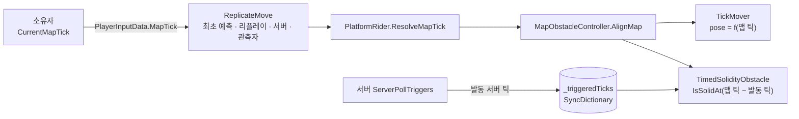

# Synchronized Panic! — 예측·리컨사일 환경의 결정성 작업

20~30인 온라인 술래잡기 게임 Synchronized Panic!에서, 클라이언트 예측·리컨사일 환경의 **맵 장애물과 입력 미러링을 결정적으로 만든 작업**을 정리한 저장소입니다. 같은 입력이면 어느 피어에서 몇 번을 다시 실행해도 같은 결과가 나오게 하는 것이 모든 작업의 공통 조건이었습니다.

G-Star 2026 인디 쇼케이스 선정작입니다.

<!-- MEDIA: 대표 GIF 1개 — 발판·무너지는 바닥 위에서 여러 플레이어가 움직이고, 술래가 Mirror Pull로 도망자들을 끌고 가는 장면 -->

> **이 저장소는 열람용입니다.** 스팀 출시 예정작이라 원본 소스는 공개하지 않고, 본인 담당 코드 일부를 [`docs/`](docs/)의 시스템별 문서에 발췌했습니다. 문서의 PR 번호는 비공개 팀 저장소 기준입니다.

---

## 프로젝트 개요

| 항목 | 내용 |
| --- | --- |
| 장르 | 온라인 멀티플레이어 파티 게임(술래잡기) |
| 핵심 규칙 | 술래가 **Mirror Pull**(동기화 스킬)을 쓰면 술래의 이동 입력이 지연되어 모든 도망자에게 강제 적용됩니다 |
| 엔진 | Unity 6 (6000.3) · C# |
| 네트워크 | FishNet 4 (클라이언트 예측 · 리컨사일, Listen Server), UGS Lobby · Relay |
| 개발 인원 | 6인 (개발 3 · 아트 3) |
| 담당 영역 | 맵 장애물, 입력 미러링 서버 검증, 어빌리티 초기 설계, 애니메이션 통합 |
| 개발 기간 | 2026.07 ~ 진행 중 |

### 예측·리컨사일 3줄 요약

1. **예측** — 각 클라이언트는 서버 응답을 기다리지 않고 자기 캐릭터의 이동을 먼저 계산해 보여 줍니다. FishNet에서는 입력 하나마다 `ReplicateMove`라는 메서드가 한 번 실행되고, 입력에는 틱(고정 간격 시뮬레이션 번호)이 붙습니다.
2. **리컨사일·리플레이** — 서버의 정답 상태가 도착하면 그 틱으로 되돌린 뒤 이후 입력들로 `ReplicateMove`를 다시 실행합니다. 이 메서드는 서버와 다른 플레이어 화면(관측자)에서도 실행되며, 결과가 서로 다르면 캐릭터가 끌리거나 튑니다.
3. **그래서** — 이동 계산이 읽는 값(장애물 위치, 미러링 입력, 버프)은 모두 "같은 입력이면 어느 피어에서 몇 번을 다시 실행해도 같은 값"이어야 합니다. 아래 작업은 전부 이 조건을 맞추는 일입니다.

---

## 가장 오래 걸린 문제 — 틱 좌표계 (v1 → v4)

FishNet 예측 환경에는 이름은 모두 "틱"이지만 기준점이 다른 값이 셋 있습니다(서버 틱, 로컬 틱, 입력에 붙는 리플리케이트 틱). 맵 장애물을 어느 틱으로 배치할지 세 번 잘못 설계한 끝에 v4(입력에 맵 틱을 싣는 구조)에 도착했고, 돌파구는 매번 추론이 아니라 실측 로그였습니다. 먼저 겪은 버프 틱 버그에서는 서버·클라이언트 양쪽 `ReplicateMove`에 같은 항목을 찍은 로그가 "클라이언트 쪽 환산이 틀렸다"는 가설을 뒤집었습니다. 서버는 같은 순간 호스트 플레이어를 2583틱, 원격 플레이어를 904틱으로 시뮬레이션하고 있었고, 틀린 쪽은 서버였습니다.

잘못된 환산이 테스트를 통과한 이유도 찾았습니다. 호스트 자기 플레이어는 로컬 틱과 서버 틱이 같고, 로컬 테스트 클론은 서버와 거의 동시에 시작해 세 좌표계가 우연히 일치했습니다. 이 경험을 "이 숫자는 **시점**인가 **길이**인가 — 시점끼리는 같은 좌표계일 때만 빼고 비교한다"는 규칙으로 팀 문서에 남기고, 검증 체크리스트에 지연 시뮬레이터를 켠 2인 이상 테스트를 넣었습니다.

<!-- MEDIA: 비교 영상 — Latency Simulator를 켠 2클라이언트, 수정 전 원격 플레이어 끌림 vs 수정 후 (버프 틱 버그 PR #31 이전 → PR #33, 또는 맵 틱 v3 → v4) -->

**상세** — [01 맵 장애물 §6 틱 좌표계 — 네 번의 설계](docs/01-map-obstacle.md#6-틱-좌표계--네-번의-설계) · [버프 틱 버그 진단 과정](docs/ai-collaboration.md#사례-4--버프-틱-버그-증상이-사라진-수정을-받아들이지-않기)

---

## 핵심 시스템

### 1. 맵 장애물 — `MapObstacleController`

> **같은 입력이면, 어느 피어에서 몇 번을 다시 실행하든 같은 장애물 상태를 봐야 한다.**

<!-- MEDIA: 탑승 가능한 이동 발판과 무너지는 바닥·격벽이 동작하는 장면 (원격 플레이어 시점 포함) -->

**문제** — 장애물은 플레이어를 태우고 밀고 떨어뜨리므로 이동 계산의 입력입니다. 입력에 붙는 리플리케이트 틱은 서버와 관측자에서 서로 다른 좌표계라, 그 틱으로 무버 위상을 정하면 같은 입력이 피어마다 다른 발판 위치를 봤습니다.

**해결** — 장애물 상태를 **맵 틱의 순수 함수**로 두고, 네트워크로는 "몇 번 장애물이 몇 번 서버 틱에 발동했는가"만 보냅니다. 맵 틱은 소유자가 입력(`PlayerInputData.MapTick`)에 서버 틱 좌표계로 직접 기록해, 예측·리플레이·서버·관측자가 모두 같은 값을 읽습니다.

- 무너지는 바닥·격벽은 사이클 상태 없이 `맵 틱 − 발동 틱`(경과 길이) 하나로 예고 → 전환 → 복구를 계산합니다
- 맵 시계는 틱당 1틱만 보정해, FishNet의 서버 틱 추정값이 튀어도 무버가 여러 틱을 건너뛰지 않습니다
- 서버는 원격 소유자의 맵 틱을 `[서버 틱 − 1초, 서버 틱 + 10틱]`으로 제한합니다



**결과** — 장애물의 네트워크 상태는 발동 틱 `SyncDictionary` 하나이고, 무버 위치는 복제하지 않으며 장애물 전용 RPC도 없습니다. 단, 맵 틱 전환(팀 저장소 PR #88) 이후 지연 환경 원격 멀티 재검증은 아직 하지 않았습니다.

**상세** — [docs/01-map-obstacle.md](docs/01-map-obstacle.md)

---

### 2. 입력 미러링 서버 검증 — `MirrorFrameHistory`

> **도망자의 예측과 서버 실행은 같은 미러 프레임을 써야 하고, 이동 값은 서버만 만든다.**

<!-- MEDIA: 술래가 Mirror Pull을 쓰는 동안 여러 도망자가 술래의 지연된 입력대로 움직이는 장면 -->

**문제** — Mirror Pull은 술래의 이동 입력을 지연시켜 모든 도망자의 수평 이동을 대신 조종합니다. 처음에는 도망자 소유자가 적용할 미러 프레임 값(방향·속도·점프)을 입력에 담아 보냈고 서버가 그대로 믿었습니다. 서버가 소유자의 샘플 시각으로 프레임을 다시 고르는 첫 수정은, 프레임 RPC가 늦게 도착할 때마다 리컨사일 스냅을 냈습니다.

**해결** — 서버가 만든 프레임 이력을 모든 피어에 두고, 소유자는 **실제로 받은 프레임의 순번**만 보냅니다. 서버는 선택을 대신하지 않고 범위만 강제합니다. 아직 실행되지 않은 프레임, 0.25초보다 오래전에 대체된 프레임, 이미 소비한 커서보다 이전 프레임은 거부하고, 위조·누락된 참조에는 자유 이동이 아니라 지금 예정된 프레임을 적용합니다. 점프는 소비 커서를 리컨사일 데이터에 넣어 리플레이에서도 정확히 한 번만 나갑니다.

**결과** — `MirrorFrameHistory`는 네트워크와 무관한 순수 클래스라, 늦게 도착한 프레임·위조 참조·커서 되감기·점프 단일 소비 같은 지연 상황을 EditMode 테스트 13개로 플레이 모드 없이 재현합니다.

**상세** — [docs/02-input-mirroring.md](docs/02-input-mirroring.md) (초기 구조 PR #1·#5·#8, 서버 검증 PR #88)

---

### 3. 어빌리티 초기 설계 — `AbilityData`

> **키 입력으로 발동하든 게임 규칙이 발동하든, 모든 어빌리티는 서버의 같은 검사를 거친다.**

**문제** — 상호작용(단발), 폭탄 인계(단발, 타이머 만료 시 입력 없이 강제 발동), Mirror Pull(누르는 동안 유지)을 같은 규칙으로 발동해야 했습니다.

**해결** — 행동은 ScriptableObject 하위 클래스로, 쿨다운·게이지 같은 런타임 상태와 공통 검사(범위 → 중복 활성 → 쿨다운 → 게이지 → 어빌리티별 조건)는 플레이어별 `AbilityController`로 나눴습니다. 클라이언트는 슬롯 번호만 요청하고, 입력 바인딩은 어빌리티가 아니라 역할별 `AbilitySet`에 둬 코드로만 발동하는 경로를 유지했습니다.

**결과** — 유령의 바람 밀치기(PR #30)는 `AbilityData`·`AbilityController`를 고치지 않고 추가됐습니다. 밀침은 서버가 속도와 남은 틱만 주입하고 `ReplicateMove`가 소비해 예측과 서버가 같은 궤적을 내며, 이 수신기는 이후 맵 장애물의 격벽 축출에 재사용됐습니다. 구조는 이후 팀 리팩토링으로 예측형 어빌리티 런타임까지 확장됐습니다.

**상세** — [docs/03-ability.md](docs/03-ability.md) (초기 커밋 기준)

---

### 4. 애니메이션 통합 — `PlayerAnimationController`

> **리플레이로 같은 틱이 다시 실행돼도 애니메이션 이벤트는 한 번만 재생돼야 한다.**

이동 파라미터(속도·접지)는 각 머신이 `ReplicateMove`의 예측 결과에서 직접 쓰고, 점프 트리거는 리플레이가 아닐 때만 로컬로 재생하며, 서버만 아는 이벤트만 `ObserversRpc`로 보냅니다. 역할(술래·도망자·유령)이 바뀌면 `NetworkObject`를 다시 스폰하지 않고 리그만 바꿔 Animator를 다시 바인딩합니다.

**상세** — [docs/04-animation.md](docs/04-animation.md) (팀원과 함께 고친 파일이라 본인 작성 부분과 PR을 구분해 적었습니다)

---

## 트러블슈팅

| 문제 | 원인 | 해결 |
| --- | --- | --- |
| 폭탄 이속 버프가 걸린 원격 플레이어가 뒤로 끌림 (호스트 자기 플레이어에서는 재현 안 됨) | 버프 시작 틱을 서버 틱으로 예약 → 클라이언트는 자기 틱 좌표계로 환산해 버프를 켜지만, 서버에서는 환산이 항등이라 원격 소유자의 입력 틱과 비교해 버프를 끔 → 리컨사일이 되돌림 | 서버가 그 플레이어의 마지막 입력 틱(`PlayerController.LastReplicateTick`) 기준으로 예약해 버프 틱을 소유자 좌표계로 통일 (PR #33) |
| Mirror Pull 시전 직후 술래가 같은 입력으로 두 번 움직임 | 시전부터 첫 지연 명령 실행 전까지 자기 입력으로 즉시 이동한 뒤, 같은 입력이 지연 큐에서 다시 재생됨 | 대기 구간을 리컨사일되는 큐 상태에서 파생해 그동안 술래 자체 이동·점프를 끔 (PR #103) |
| 호스트에서 잡힌 도망자 모델이 디스폰 직전 순간 다시 보임 | 팀원이 만든 예측 잡기 숨김이 `OnDisable`에서 렌더러를 복원했는데, 호스트에서는 서버가 플레이어를 비활성화한 뒤 틱 스무더가 분리된 그래픽을 다시 붙임 | 복원 시점을 풀에서 다시 활성화되는 `OnEnable`로 옮김 (PR #98) |

---

## AI 활용 방식

코드 대부분은 AI(Claude)가 작성했고, 요구사항과 미결정 사항 확정, 설계 선택, 플레이 테스트와 실측 검증은 제가 했습니다.

- 구현을 맡기기 전에 기획 제약을 먼저 확정하고, 설계 문서와 반대 의견을 요구했습니다.
- AI의 정당화는 실측으로 확인했습니다. 틱 좌표계 v3에서 AI가 "감수할 만한 대가"라고 한 피어 간 차이를 원격 플레이에서 버그로 확인해 v4로 바꿨습니다.
- 증상이 사라진 것과 고쳐진 것을 따로 확인했습니다. 버프 틱 버그의 1차 수정(PR #31)은 끌림만 없애고 버프가 꺼진 상태로 맞춘 것이어서 되돌렸습니다.

**상세** — [docs/ai-collaboration.md](docs/ai-collaboration.md) (작업 방식, 사례 4개, 버프 틱 버그 전 과정)

---

## 기타 담당

`PlayerController` · `RoundController` 책임 분리 리팩토링, 튜토리얼, 재화 시스템(로컬 지갑), 사운드 연동

---

## 저장소 구성

```
README.md
docs/
├── 01-map-obstacle.md      구조 · 한 틱의 흐름 · 설계 결정 · 틱 좌표계 변천 · 발췌 코드
├── 02-input-mirroring.md   신뢰 경계 · 서버 검증 · 테스트
├── 03-ability.md           초기 커밋 기준
├── 04-animation.md         본인 작성 범위 · 리플레이 안전한 애니메이션 경로
└── ai-collaboration.md     작업 방식 · 사례 4개 · 버프 틱 버그 전 과정
```
