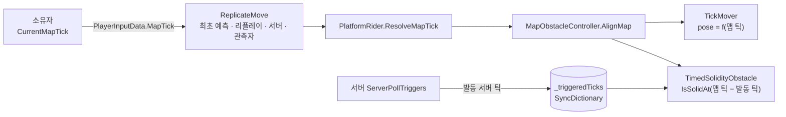

# Synchronized Panic! — 네트워크 게임플레이 시스템

20~30인 온라인 술래잡기 파티 게임 **Synchronized Panic!**에서 제가 설계·구현한 시스템과, 그 과정에서 AI를 어떻게 활용했는지 정리한 저장소입니다.

<!-- TODO: 대표 이미지/영상 썸네일 -->

**🎥 [플레이 영상](영상 링크 자리)** · **🎮 [Steam 페이지](스팀 링크 자리)** · G-Star 2026 인디 쇼케이스 출품

> **이 저장소는 열람용입니다.** 스팀 출시 예정작이라 원본 소스는 공개하지 않고, 본인 담당 코드 일부를 [`docs/`](docs/)의 시스템별 문서에 발췌했습니다.

---

## 프로젝트 개요

| 항목 | 내용 |
| --- | --- |
| 장르 | 온라인 멀티플레이어 파티 게임(술래잡기) |
| 핵심 규칙 | 술래가 **동기화 스킬을**을 쓰면 술래의 이동 입력이 지연되어 모든 도망자에게 강제 적용됩니다 |
| 엔진 | Unity 6 (6000.3) · C# |
| 네트워크 | FishNet 4 (클라이언트 예측 · 리컨사일, Listen Server), UGS Lobby · Relay |
| 개발 인원 | 6인 (개발 3 · 아트 3) |
| 담당 영역 | 맵 장애물, 입력 미러링 서버 검증, 어빌리티 초기 설계, 애니메이션 통합 |
| AI 도구 | Claude (설계 검토 · 코드 작성 · 디버깅), Unity CLI |

개발 기간: 2026.07 ~ 진행 중

---

## AI 활용 방식

AI는 코드 생성기보다 **설계에 반론을 받는 상대와 디버깅 보조**로 썼습니다. 코드 대부분은 AI가 작성했고, 무엇을 적용할지와 검증은 제가 했습니다.

| 상황 | 내가 한 것 | 결과 |
| --- | --- | --- |
| 어빌리티 입력 설계 | AI가 `AbilityData`에 입력 액션을 넣자고 제안 → GAS에서 입력 바인딩이 선택적이고, 코드로만 발동하는 어빌리티도 있었던 경험으로 반박 | 입력 바인딩을 `AbilitySet`으로 분리하고 코드 발동 경로 유지 |
| 미러 상태 위치 | AI 첫 코드가 미러 상태를 라운드 관리자의 SyncVar에 둔 것에 문제 제기 | 시전자별 `MirrorEffectSource`가 상태를 소유 |
| 맵 장애물 설계 | 요구사항과 미결정 사항을 먼저 확정하고 설계 문서부터 요청, 반대 의견을 명시적으로 요구. AI가 감수할 만하다고 한 플레이어별 틱 차이를 원격 플레이에서 버그로 확인 | 장애물 판정을 입력에 실린 `MapTick` 하나로 통일 |
| 버프 틱 버그 | 러버밴딩은 사라졌지만 버프가 제대로 걸리지 않는 첫 수정을 받아들이지 않고 재보고, 서버·클라이언트 로그를 같은 틱끼리 나란히 제공 | 원인 확정 후 실제 수정 |

**배운 점**
1. **설계를 묻기 전에 기획 제약을 전부 적는다.** 역할 고정 여부, 도망자 입력 유무를 나중에 알려 AI의 구조 권고가 세 번 바뀌었습니다.
2. **증상이 사라진 것과 고쳐진 것은 따로 확인한다.** 동기화 버그는 서버·클라이언트 양쪽 로그를 같은 틱끼리 나란히 줘야 원인이 한 번에 잡혔습니다.
3. **AI는 묻지 않으면 자기 설계의 대가를 먼저 말하지 않는다.** 반대 의견을 요구하고, AI의 정당화는 실측으로 확인합니다.

**상세** — [docs/ai-collaboration.md](docs/ai-collaboration.md) (작업 방식, 버프 틱 버그 전 과정)

---

## 핵심 시스템

### 1. 맵 장애물 — `MapObstacleController`

리컨사일마다 `ReplicateMove`가 과거 틱부터 다시 실행되므로, 장애물도 같은 입력이면 어느 피어에서든 같은 상태여야 했습니다. **장애물 상태를 맵 틱의 순수 함수로 두고, 발동 틱 하나만 동기화**해 해결했습니다.

- `MapObstacleController` — 유일한 네트워크 상태(장애물 ID → 발동 서버 틱 `SyncDictionary`) 소유, 서버 발동·격벽 축출
- `MapObstacleController.AlignMap` — 무버·붕괴·격벽 콜라이더를 주어진 맵 틱 상태로 배치. 같은 틱 재호출은 무시
- `TickMover` — pose가 맵 틱의 순수 함수인 무버 베이스. `EvaluateCarry`의 틱당 변위로 탑승·측면 밀침 처리
- `TimedSolidityObstacle` — 무너지는 바닥·격벽. 사이클 상태 없이 발동 후 경과 틱에서 예고 → 전환 → 복구 파생
- `PlatformRider` — 입력의 맵 틱을 정하고 플레이어를 발판과 함께 이동

**주요 설계 결정**
- **맵 틱을 입력 데이터로** — 리플리케이트 틱은 서버와 관측자에서 틱 공간이 달라 같은 입력이 다른 무버 위상을 봤습니다. 소유자가 `PlayerInputData.MapTick`(서버 틱 공간)을 찍어 모든 피어가 같은 값을 읽습니다
- **발동 틱과 같은 틱 공간** — 경과 틱은 `맵 틱 − 발동 틱` 뺄셈 하나로, 클라이언트 틱 환산이 없습니다
- **맵 시계는 틱당 1틱만 보정** — `Tick`이 재앵커링으로 튀어도 무버가 여러 틱을 건너뛰지 않습니다
- **서버 재검증** — `ServerClampMapTick`이 원격 맵 틱을 `[Tick − 1초, Tick + 10틱]`으로 제한합니다
- **연출 분리** — 무버는 플레이어 틱 스무더와 같은 2틱 지연으로 그리고, 원격 탑승자는 `RemoteRiderPresenter`가 표시만 보정합니다



**결과** — 장애물 동기화 상태는 발동 틱 `SyncDictionary` 하나이고, 무버 위치는 복제하지 않습니다.

**AI 활용** — AI에게 맡긴 것: 설계 문서·코드 초안, `CharacterController` 제약 조사, 버그 원인 분석 / 내가 결정·검증한 것: 요구사항과 미결정 사항 확정, `NetworkObject` 채택·`NetworkTransform` 기각, AI가 감수할 만하다고 한 플레이어별 틱 차이를 원격 플레이에서 버그로 확인하고 `MapTick`으로 교체

**상세** — [docs/01-map-obstacle.md](docs/01-map-obstacle.md) (틱 좌표계 설계 변천 v1 → v4 포함)

---

### 2. 입력 미러링 — `MirrorFrameHistory`

Mirror Pull은 술래의 이동 입력을 지연시켜 모든 도망자의 수평 이동을 대신 조종하는 능력입니다. 처음에는 도망자 소유자가 적용할 미러 프레임 값을 입력에 담아 보냈고 서버가 그대로 믿었습니다. **서버가 만든 프레임 이력을 모든 피어에 두고, 소유자는 프레임 순번만 보내게** 바꿨습니다.

- `MirrorInputFrame` / `MirrorInputReference` — 서버가 만든 이동 기록과, 그중 하나를 순번으로 가리키는 소유자 요청. 요청에는 이동 값이 없음
- `MirrorFrameHistory.Add` — 서버가 만든 프레임만 512개 링 버퍼에 순서대로 보관. 스트림이 바뀌면 이전 시전의 프레임을 버림
- `MirrorFrameHistory.Resolve` — 소유자가 고른 순번을 서버 범위 안에서 받아들이고 플레이어별 소비 커서를 전진

**주요 설계 결정**
- **시각 대신 순번** — 서버가 소유자의 샘플 틱으로 프레임을 다시 고르면, RPC가 늦을 때 소유자가 받지 못한 프레임을 적용해 리컨사일 스냅이 났습니다. 그래서 소유자가 실제로 받은 순번을 보냅니다
- **서버는 범위만 강제** — 실행 전 프레임, 0.25초보다 오래전에 대체된 프레임, 커서보다 이전 프레임은 거부합니다. 위조 참조는 자유 이동이 아니라 지금 예정된 프레임이 됩니다
- **점프는 한 번만** — 커서 이후의 점프를 합쳐 소비하고, 커서를 리컨사일 데이터에 넣어 리플레이도 같은 결과를 냅니다
- **이전 작업** — 초기 `MirrorEffectSource`를 만들고, 술래 방향을 입력 데이터로 왕복시키지 않고 `ReplicateMove`가 직접 읽게 해 반응 지연을 줄였습니다. 정지 시 역주행은 지수 감쇠로 없앴습니다

**결과** — `MirrorFrameHistoryTests`의 EditMode 테스트 13개가 위조·누락 참조, 늦게 도착한 프레임, 나이 창, 커서 되감기, 점프 단일 소비, 스트림 교체를 다룹니다.

**AI 활용** — AI에게 맡긴 것: FishNet 예측 구조 설명과 첫 구현 코드 / 내가 결정·검증한 것: 미러 상태를 라운드 관리자 SyncVar에 둔 AI 첫 코드에 문제를 제기해 시전자별 `MirrorEffectSource`로 옮김

**상세** — [docs/02-input-mirroring.md](docs/02-input-mirroring.md)

---

### 3. 어빌리티 초기 설계 — `AbilityData`

역할마다 다른 행동(Mirror Pull, 폭탄 인계, 상호작용)을 같은 규칙으로 발동해야 했습니다. **행동은 SO 하위 클래스로, 공통 검사와 런타임 상태는 `AbilityController`로** 나눠 해결했습니다.

- `AbilityData` — 어빌리티 SO 베이스. 발동 방식(Instant / Hold)·쿨다운·게이지 설정과 서버 전용 훅(`ServerCanActivate`, `OnActivateServer`, `OnDeactivateServer`)
- `AbilitySet` — 역할별 어빌리티와 입력 액션 목록. 서버가 부여하고 `BaseData` Id로 동기화
- `AbilityController.ServerTryActivateSlot` — 범위 → 중복 활성 → 쿨다운 → 게이지 → 어빌리티별 조건 순서의 공통 검사

**주요 설계 결정**
- **SO에는 런타임 상태 없음** — 공유 에셋이므로 쿨다운·게이지는 플레이어별 `AbilityController`가 갖습니다
- **클라이언트는 슬롯 번호만 요청** — 판정은 서버가 다시 합니다
- **예시: 유령의 바람 밀치기 `WindPullAbilityData`** — 유령만 허용하고, 서버 `Physics.OverlapSphere`로 찾은 술래·도망자의 `PushEffectReceiver.ServerApplyPush`에 밀침 속도를 넣습니다. 감쇠율을 상수로 둬 리컨사일 스냅샷만으로 예측 리플레이가 서버와 같아집니다

**결과** — 바람 밀치기는 `AbilityData`·`AbilityController`를 고치지 않고 추가됐고, 이 구조는 이후 팀 리팩토링으로 예측형 어빌리티 런타임까지 확장됐습니다.

**AI 활용** — AI에게 맡긴 것: 공통 생명주기 추출안·코드 초안, 유령 설계 검토 / 내가 결정·검증한 것: GAS 경험을 근거로 `AbilityData`에 입력 액션을 두자는 AI 제안을 반박해 입력 바인딩을 `AbilitySet`으로 분리, 어빌리티와 상태(SyncVar)의 구분 기준 결정

**상세** — [docs/03-ability.md](docs/03-ability.md)

---

### 4. 애니메이션 통합 — `PlayerAnimationController`

<!-- TODO: 본인 커밋 범위(git log -L) 확인 후 확정 -->

예측·리컨사일 환경에서는 같은 틱이 여러 번 다시 실행되므로, 애니메이션을 그대로 동기화하면 동작이 두 번 재생됩니다. **이동 상태는 각 머신이 예측 결과에서 직접 만들고, 서버가 주도하는 이벤트만 네트워크로 보내** 해결했습니다.

- `PlayerAnimationController.UpdateLocomotion` — `ReplicateMove`에서 모든 머신이 호출. 리플레이 중에도 마지막 틱 값으로 수렴하는 파라미터만 씀
- `PlayerAnimationController.PlayJump` — 점프는 예측으로 이미 모든 머신에 전달되므로 로컬 Animator 트리거로 재생하고, 호출부가 리플레이 재발동을 막음
- `PlayerAnimationController.ServerPlayTrigger` — 서버 주도 트리거만 `ObserversRpc`로 전달
- `PlayerAnimationController.ApplyRole` — 역할별 캐릭터 리그(술래·도망자·유령)를 전환하고 Animator를 다시 바인딩

**상세** — [docs/04-animation.md](docs/04-animation.md)

---

## 트러블슈팅

| 문제 | 원인 | 해결 |
| --- | --- | --- |
| 폭탄 이속 버프가 걸린 원격 플레이어가 뒤로 끌림 (호스트 자기 플레이어에서는 재현 안 됨) | 버프 시작 틱을 서버 틱으로 예약 → 클라이언트는 자기 틱 공간으로 환산해 버프를 켜지만, 서버에서는 환산이 항등이라 원격 소유자의 입력 틱과 비교해 버프를 끔 → 리컨사일이 되돌림 | 서버가 그 플레이어의 마지막 입력 틱(`PlayerController.LastReplicateTick`) 기준으로 예약해 버프 틱을 소유자 틱 공간으로 통일 |
| Mirror Pull 시전 직후 술래가 같은 입력으로 두 번 움직임 | 시전부터 첫 지연 명령 실행 전까지 자기 입력으로 즉시 이동한 뒤, 같은 입력이 지연 큐에서 다시 재생됨 | 대기 구간을 리컨사일되는 큐 상태에서 파생해 그동안 술래 자체 이동·점프를 끔 |
| 호스트에서 잡힌 도망자 모델이 디스폰 직전 순간 다시 보임 | 숨긴 렌더러를 `OnDisable`에서 복원했는데, 호스트에서는 서버가 플레이어를 비활성화한 뒤 틱 스무더가 분리된 그래픽을 다시 붙임 | 복원 시점을 풀에서 다시 활성화되는 `OnEnable`로 옮김 |

---

## 기타 담당

`PlayerController` · `RoundController` 책임 분리 리팩토링, 튜토리얼, 재화 시스템(로컬 지갑), 사운드 연동

---

## 저장소 구성

```
README.md
docs/
├── ai-collaboration.md     작업 방식 · 사례 4개 · 버프 틱 버그 전 과정
├── 01-map-obstacle.md      구조 · 한 틱의 흐름 · 설계 결정 · 틱 좌표계 변천 · 발췌 코드
├── 02-input-mirroring.md   신뢰 경계 · 서버 검증 · 테스트
├── 03-ability.md           초기 커밋 기준
└── 04-animation.md
```
