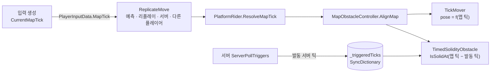
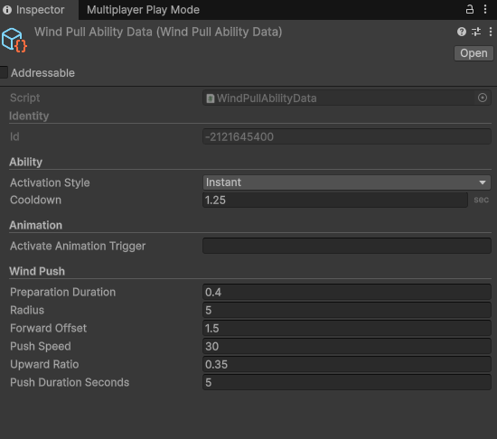

# Synchronized Panic!

10~20명이 함께 하는 온라인 술래잡기 게임입니다. 술래가 스킬(Mirror Pull)을 쓰면 술래의 이동 입력이 모든 도망자에게 그대로 적용되는 것이 핵심 규칙입니다.
G-Star 2026 인디 쇼케이스에 선정됐고, 스팀 출시를 준비하고 있습니다.

<div align="center">

[](https://youtu.be/lI4AttoxDCc)

**🎥 [포트폴리오 영상 보기](https://youtu.be/lI4AttoxDCc)** &nbsp;
</div>

<!-- MEDIA: 대표 GIF 1개 — 발판·무너지는 바닥 위에서 여러 플레이어가 움직이고, 술래가 Mirror Pull로 도망자들을 끌고 가는 장면 -->

> 열람용 저장소입니다. 스팀 출시 예이라 원본 소스는 올리지 않았고, 제가 맡은 코드 일부를 [`docs/`](docs/)의 시스템별 문서에 발췌했습니다.

---

## 프로젝트 개요

| 항목 | 내용 |
| --- | --- |
| 장르 | 온라인 멀티플레이어 술래잡기 (10~20인) |
| 엔진 | Unity 6 (6000.3) · C# |
| 네트워크 | FishNet 4 (클라이언트 예측 · 리컨사일, Listen Server), UGS Lobby · Relay |
| 개발 인원 | 6인 (개발 3 · 아트 3) |
| 담당 | 맵 장애물, 입력 미러링, 어빌리티 초기 설계, 애니메이션 연동 |
| 개발 기간 | 2026.07 ~ 진행 중 |
| 테스트 | 13명 온라인 플레이테스트에서 정상 동작 확인 |

<details>
<summary>예측·리컨사일이란</summary>

- 각 클라이언트는 서버 응답을 기다리지 않고 자기 캐릭터 이동을 먼저 계산해 보여 줍니다. FishNet에서는 입력마다 `ReplicateMove`가 한 번 실행되고, 입력에는 틱 번호가 붙습니다.
- 서버 결과가 도착하면 그 틱으로 되돌린 뒤 이후 입력으로 `ReplicateMove`를 다시 실행합니다. 이 메서드는 서버와 다른 플레이어 화면에서도 실행됩니다.
- 그래서 이동 계산에 쓰이는 값(장애물 위치, 미러링 입력, 버프)은 어디서 몇 번을 다시 실행해도 같아야 합니다. 이 값이 어긋나면 캐릭터가 끌리거나 튑니다.

</details>

---


## 구현한 시스템

### 1. 맵 장애물

https://github.com/user-attachments/assets/bd8814b2-6207-4567-927f-c85bd820fa24

무너지는 바닥과 다리, 플레이어가 지나가면 닫히는 격벽, 점프대, 올라탈 수 있는 이동·회전 발판을 만들었습니다. 장애물 프리팹을 맵에 배치하고 인스펙터에서 주기나 타이밍만 조정하면 됩니다.

<!-- MEDIA: 이동 발판과 무너지는 바닥·격벽이 동작하는 장면 (원격 플레이어 시점 포함) -->

- 장애물 상태는 틱 번호만 있으면 계산됩니다. 발판 위치는 `TickMover.EvaluatePose(tick)`로, 바닥 붕괴와 격벽 단계는 발동 후 지난 틱 수로 정해져서 리플레이로 같은 틱을 다시 실행해도 결과가 같습니다.
- 네트워크로는 어떤 장애물이 몇 번 틱에 발동했는지만 보냅니다(`SyncDictionary` 하나). 발판 위치는 동기화하지 않고 `NetworkTransform`도 쓰지 않습니다.
- `CharacterController`는 움직이는 발판을 따라가지 않고, 리플레이 중에는 충돌 콜백도 다시 오지 않습니다. 그래서 탑승과 측면 밀림은 이동 계산 안에서 직접 처리합니다.
- 입력을 만들 때 그 시점의 맵 틱을 같이 기록합니다(`PlayerInputData.MapTick`). 서버와 다른 플레이어 화면도 이 값을 읽어 같은 발판 위치를 봅니다. 서버는 이 값이 정상 범위를 벗어나면 잘라냅니다.
- 흔들림, 낙하, 색 변화, 소리 같은 연출은 `ObstaclePresenter` 컴포넌트로 분리했습니다.



**상세** [docs/01-map-obstacle.md](docs/01-map-obstacle.md)

---

### 2. 입력 미러링 (Mirror Pull)

https://github.com/user-attachments/assets/40378aca-ce7a-47ca-ae63-e73a72c8c77f


술래의 이동 입력을 조금 늦춰서 모든 도망자의 수평 이동에 적용하는 스킬입니다. 처음 구조를 만들었고, 이후 서버 검증을 붙였습니다.

<!-- MEDIA: 술래가 Mirror Pull을 쓰는 동안 여러 도망자가 술래의 입력대로 움직이는 장면 -->

- 시전자마다 `MirrorEffectSource`를 두고 미러링 상태를 갖게 했습니다. 술래 방향을 입력 데이터로 주고받지 않고 `ReplicateMove`에서 바로 읽게 해서 반응 지연을 줄였습니다.
- 처음에는 도망자 클라이언트가 자기가 적용한 미러 값(방향, 속도, 점프)을 그대로 서버에 보냈습니다. 이를 서버가 만든 프레임 기록(`MirrorFrameHistory`)을 모든 피어가 갖고, 클라이언트는 "몇 번째 프레임으로 계산했는지"만 보내도록 바꿨습니다.
- 서버는 아직 실행 시각이 안 된 프레임, 0.25초 넘게 지난 프레임, 이미 지나간 프레임은 받지 않습니다. 잘못된 참조가 오면 그 시점에 예정된 프레임을 적용합니다.
- 점프는 리플레이에서도 한 번만 나가도록 마지막으로 쓴 프레임을 리컨사일 데이터에 넣었습니다.
- `MirrorFrameHistory`는 네트워크 없이 동작하는 클래스로 분리해서, 프레임이 늦게 오거나 위조된 경우를 EditMode 테스트 13개로 확인합니다.

**상세** [docs/02-input-mirroring.md](docs/02-input-mirroring.md)

---

### 3. 어빌리티 (초기 설계)

https://github.com/user-attachments/assets/117a8171-1b48-427b-a2ea-64661f590134

역할마다 다른 능력(상호작용, 폭탄 넘기기, Mirror Pull)을 같은 규칙으로 발동하는 구조를 설계했습니다. Mirror Pull과 유령의 바람 밀치기는 제가, 폭탄 넘기기는 팀원이 이 구조로 만들었습니다.

- `AbilityData`(ScriptableObject)는 쿨다운, 게이지, 발동 방식(즉시 / 누르는 동안) 같은 설정과 서버에서 실행할 동작만 갖습니다. 게이지와 쿨다운 같은 상태는 플레이어마다 붙는 `AbilityController`가 갖습니다.



- 클라이언트는 슬롯 번호만 보내고, 서버가 쿨다운 → 게이지 → 어빌리티별 조건 순으로 다시 검사합니다.
- 키 입력은 어빌리티가 아니라 역할별 목록(`AbilitySet`)에 넣었습니다. 게임 규칙이 키 입력 없이 어빌리티를 발동하는 경우를 위해, 코드로 발동하는 경로도 같은 검사를 거치게 했습니다.
- 유령의 바람 밀치기는 `AbilityData` 하위 클래스 하나로 추가했습니다. 서버는 밀침 속도와 남은 틱만 넣고 이동 계산이 그 값을 쓰기 때문에 예측과 서버 결과가 같습니다. 이 밀침 처리는 나중에 격벽이 닫힐 때 플레이어를 밀어내는 데도 썼습니다.
- 이후 팀원이 어빌리티를 예측 구조로 옮기면서 많이 바뀌었고, 문서는 처음 설계한 버전 기준입니다.

**상세** [docs/03-ability.md](docs/03-ability.md)

---

### 4. 애니메이션 연동

- 속도와 접지 여부는 각 머신이 이동 계산 결과로 직접 Animator에 넣습니다. 따로 동기화하지 않습니다.
- 점프 트리거는 리플레이 중에는 다시 재생하지 않습니다.
- 서버만 아는 이벤트만 `ObserversRpc`로 보냅니다.
- 역할(술래, 도망자, 유령)이 바뀌면 오브젝트를 다시 만들지 않고 캐릭터 리그만 바꿉니다.
- 모델에서 가져온 애니메이션 클립 이름을 한 번에 정리하는 에디터 도구를 만들었습니다.

**상세** [docs/04-animation.md](docs/04-animation.md)

---

## 트러블슈팅

### 폭탄 버프를 받은 원격 플레이어가 뒤로 끌림

**문제**
폭탄을 받으면 이동 속도 버프가 적용됐는데, 이 동안 원격 클라이언트의 캐릭터가 계속 뒤로 끌렸습니다. 호스트 본인 캐릭터에서는 생기지 않았습니다.

**원인**
서버와 클라이언트 양쪽에 같은 로그를 찍어 비교해 보니, 서버는 같은 순간에 호스트 플레이어를 2583틱, 원격 플레이어를 904틱으로 계산하고 있었습니다. 입력에 붙는 틱 번호는 그 플레이어 클라이언트 기준이었습니다. 버프 시작 틱은 서버 틱으로 정해졌는데, 클라이언트는 자기 기준으로 바꿔서 버프를 켰고 서버는 바꾸지 않고 비교해서 버프가 꺼져 있었습니다. 클라이언트만 빨리 달리니 리컨사일이 계속 뒤로 당겼습니다.

**해결**
서버가 그 플레이어의 마지막 입력 틱(`PlayerController.LastReplicateTick`)을 기준으로 버프 시점을 정하게 해서 양쪽 기준을 맞췄습니다.
처음에는 클라이언트 쪽 변환을 없애는 수정을 했는데, 끌림은 사라졌지만 버프가 몇 초 늦게 걸렸습니다. 확인해 보니 양쪽 모두 버프가 꺼진 상태로 맞춰진 것이어서 되돌렸습니다.

**결과**
서버와 클라이언트가 같은 틱에 버프를 켜고 끄게 됐습니다. 틱 숫자를 다룰 때 "시점인지 길이인지" 먼저 구분하는 규칙을 팀 문서로 정리했고, 지연 시뮬레이터를 켠 2인 이상 테스트를 검증 절차에 넣었습니다. 호스트나 로컬 테스트에서는 틱 기준이 우연히 같아서 이런 버그가 드러나지 않았기 때문입니다.

---

### 원격 플레이에서 발판 위 플레이어가 발판과 따로 움직임

**문제**
원격 플레이에서 발판 위에 선 다른 플레이어가 발판과 어긋나게 움직였고, 바닥이 무너지거나 격벽이 닫힐 때마다 위치 보정이 생겼습니다.

**원인**
발판 위치는 입력의 틱 번호로, 바닥·격벽 상태는 각자의 로컬 틱을 변환해서 계산했습니다. 위의 버프 문제와 같은 이유로 이 값은 서버와 다른 플레이어 화면에서 기준이 달랐습니다. 처음 설계할 때 AI는 이 차이를 감수할 만하다고 설명했지만, 다시 따져 보니 원격 플레이에서 실제로 문제가 됐습니다.

**해결**
입력을 만들 때 서버 틱 기준의 맵 틱을 입력에 같이 기록하고, 모든 곳에서 이 값으로 발판과 바닥·격벽 상태를 계산하게 했습니다.

**결과**
같은 입력이면 서버와 모든 클라이언트가 같은 장애물 상태를 봅니다. 바닥·격벽 판정에 있던 틱 변환도 없어졌습니다.

---

### Mirror Pull 시전 직후 술래가 같은 입력으로 두 번 움직임

**문제**
Mirror Pull을 쓰는 순간 술래가 한 번 움직이고, 잠시 뒤 같은 움직임을 한 번 더 했습니다.

**원인**
시전 후 첫 지연 입력이 실행되기 전까지 술래는 자기 입력으로 바로 움직였는데, 같은 입력이 지연 큐에 들어가 나중에 다시 실행됐습니다.

**해결**
이 대기 구간을 리컨사일되는 큐 상태에서 판단하게 하고, 그동안 술래 자신의 이동과 점프를 막았습니다.

**결과**
술래 입력은 지연 큐를 통해 한 번만 적용되고, 리플레이에서도 같은 결과가 나옵니다.

---

### 호스트에서 잡힌 도망자 모델이 사라지기 직전 다시 보임

**문제**
호스트 화면에서 술래가 도망자를 잡으면, 도망자 모델이 사라지기 직전 잠깐 다시 나타났습니다.

**원인**
잡힌 도망자의 렌더러를 숨겼다가 `OnDisable`에서 다시 켜고 있었습니다. 호스트에서는 서버가 플레이어를 비활성화한 뒤에 틱 스무더가 떼어 둔 그래픽을 다시 붙이기 때문에, 그 순간 모델이 보였습니다.

**해결**
렌더러를 다시 켜는 시점을 오브젝트 풀에서 다시 꺼낼 때(`OnEnable`)로 옮겼습니다.

**결과**
호스트에서도 잡힌 모델이 다시 보이지 않습니다.

---

## AI 활용

코드는 대부분 Claude가 작성했습니다. 저는 기획 조건과 설계 방향을 정하고, 실제 플레이와 로그로 결과가 맞는지 확인했습니다.

초기에는 Claude 채팅에 Unity MCP를 연결해 썼습니다. 이후에는 Unity MCP를 쓰지 않고, Claude 채팅에서 기획과 설계를 정한 뒤 그 내용을 프롬프트로 정리해 Claude Code에서 구현했습니다. 컴파일 확인과 에디터 작업은 Unity CLI로 했습니다.

- 구현을 맡기기 전에 기획 조건과 정해지지 않은 부분을 먼저 정리하고, 설계 문서와 반대 의견을 먼저 받았습니다.
- AI가 제안한 구조를 그대로 쓰지 않았습니다. 어빌리티 클래스에 `InputAction` 멤버를 넣자는 제안은 UE5 GAS를 써 본 경험을 근거로 반대하고 `AbilitySet`으로 넣었습니다.
- AI 설명이 그럴듯해도 직접 확인했습니다. 발판을 플레이어마다 다른 틱으로 배치하는 것을 AI는 감수할 만한 대가라고 했지만, 원격 플레이에서 버그로 나타났습니다.

**상세** [docs/ai-collaboration.md](docs/ai-collaboration.md)

---

## 기타 담당

`PlayerController` · `RoundController` 책임 분리 리팩토링, 튜토리얼, 재화 시스템(로컬 지갑), 사운드 연동

---

## 저장소 구성

```
README.md
docs/
├── 01-map-obstacle.md      구조, 한 틱의 흐름, 설계 결정, 틱 기준 변경 과정, 코드 발췌
├── 02-input-mirroring.md   서버 검증 구조, 테스트
├── 03-ability.md           초기 설계 기준
├── 04-animation.md         담당 범위, 리플레이를 고려한 애니메이션 처리
├── ai-collaboration.md     작업 방식, 사례, 버프 틱 버그 전 과정
└── images/
```
