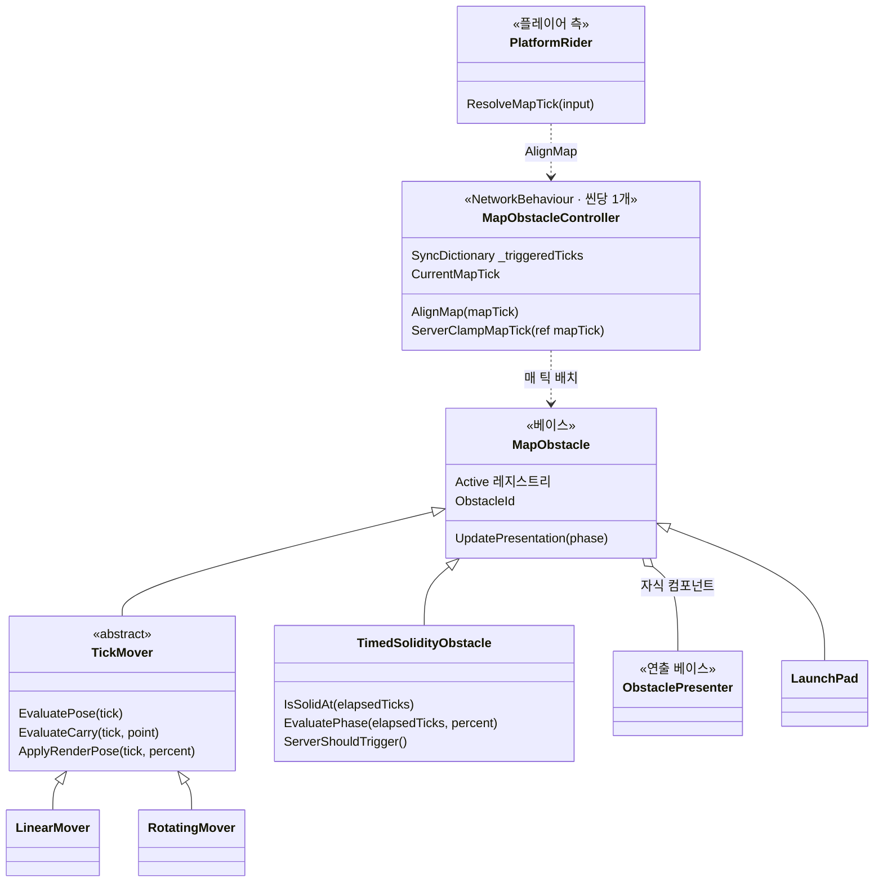
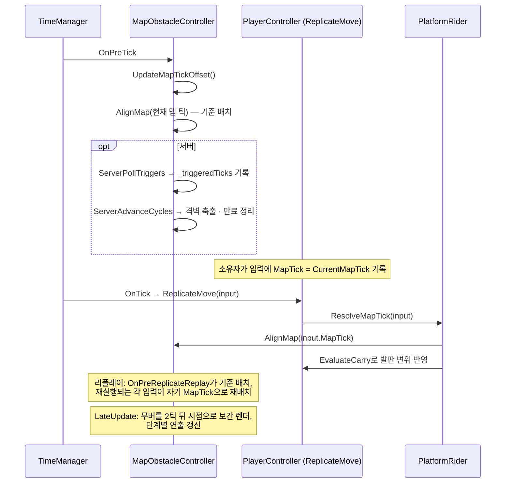

# 맵 장애물 — `MapObstacleController`

[← README](../README.md)

무너지는 바닥·다리, 지나가면 닫히는 격벽, 점프대, 탑승할 수 있는 이동·회전 블럭을 클라이언트 예측 환경에서 동작하게 만든 시스템입니다.
장애물 상태는 틱 번호만으로 계산하고, 네트워크로는 장애물마다 "몇 번 서버 틱에 발동했는지"만 보냅니다.

---

## 1. 풀어야 했던 문제

이 게임의 플레이어 이동은 FishNet의 `[Replicate]` 메서드(`PlayerController.ReplicateMove`) 안에서 계산됩니다. 같은 메서드가 네 곳에서 실행됩니다.

| 실행 위치 | 언제 |
| --- | --- |
| 소유 클라이언트의 최초 예측 | 입력을 만든 직후 |
| 소유 클라이언트의 리플레이 | 서버 상태를 받아 리컨사일할 때, 과거 틱부터 다시 |
| 서버 | 원격 입력이 도착했을 때 |
| 관측 클라이언트 | 다른 플레이어의 입력을 받아 재현할 때 |

장애물은 플레이어를 태우고, 밀고, 떨어뜨리기 때문에 이동 계산에 직접 들어갑니다. 네 곳 중 한 곳이라도 장애물 상태를 다르게 보면 서버와 예측 결과가 달라지고, 리컨사일이 플레이어를 끌어당깁니다. 그래서 같은 입력이라면 어디서 몇 번을 다시 실행해도 같은 장애물 상태를 보도록 만들어야 했습니다.

---

## 2. 동기화하는 것과 계산하는 것

| 상태 | 처리 방식 |
| --- | --- |
| 무버의 위치·회전 | **복제하지 않음.** `TickMover.EvaluatePose(tick)`가 틱만으로 계산 |
| 붕괴·격벽의 단계 (예고 → 전환 → 복구) | **복제하지 않음.** 발동 후 경과 틱에서 `TimedSolidityObstacle.IsSolidAt`이 파생 |
| 발동 여부와 시각 | `MapObstacleController._triggeredTicks` — `SyncDictionary<int, uint>` (장애물 ID → 발동 서버 틱) |
| 장애물 ID | `NetworkObject.ObjectId` |

장애물 전용 RPC는 없고, 플레이어 리컨사일 데이터에도 장애물 상태를 담지 않습니다. 무버에는 `NetworkTransform`을 붙이지 않았습니다.

---

## 3. 구조



| 클래스 | 역할 |
| --- | --- |
| `MapObstacleController` | 시스템의 유일한 네트워크 상태(발동 틱)를 소유합니다. 시뮬레이션할 틱에 맞춰 모든 장애물 콜라이더를 배치하고, 서버에서 발동 감지·격벽 축출을 맡고, 렌더링용 보간을 합니다 |
| `MapObstacle` | 모든 장애물의 베이스. 활성 인스턴스 레지스트리, 네트워크 ID, 발밑 질의, 연출 디스패치 |
| `TickMover` | pose가 틱의 순수 함수인 무버 베이스. `LinearMover`(왕복), `RotatingMover`(회전)가 `EvaluatePose`만 구현합니다 |
| `TimedSolidityObstacle` | 무너지는 바닥·다리(`StartsSolid` 켬)와 격벽(끔). 사이클 상태를 저장하지 않습니다 |
| `LaunchPad` | 점프대. 발사 세기만 갖고, 적용은 플레이어 이동 계산이 합니다 |
| `PlatformRider` | 플레이어 쪽 컴포넌트. 입력의 맵 틱을 정하고, 발판의 틱당 변위를 플레이어 이동에 더합니다 |
| `RemoteRiderPresenter` | 관측자 화면에서 원격 탑승자의 표시 위치만 보정합니다 |
| `ObstaclePresenter` 계열 | 예고·발동·복구 단계별 연출(흔들림, 낙하, 스케일, 색, 오브젝트 토글, 사운드). 시뮬레이션에 영향을 주지 않습니다 |

---

## 4. 한 틱의 흐름



`AlignMap`은 같은 틱으로 다시 불리면 아무것도 하지 않으므로, 클라이언트에서는 대부분 캐시에서 끝납니다. 서버는 한 프레임에 여러 플레이어의 입력을 각자의 맵 틱으로 실행하므로 실제 재배치가 여기서 일어납니다.

---

## 5. 설계 결정

### 5.1 충돌 이벤트 대신 `ReplicateMove` 안의 명시적 질의

`CharacterController`는 Rigidbody가 아니라 물리 솔버 밖에서 움직입니다. 발판이 움직여도 캐릭터를 따라 옮겨 주지 않고, `OnCollisionEnter`도 발생하지 않습니다. 또 리컨사일 리플레이 중에는 물리 콜백이 다시 돌지 않습니다.

그래서 탑승과 측면 밀침은 `ReplicateMove` 안에서 직접 계산합니다. 발밑 장애물을 SphereCast로 찾고, 그 틱에 발판이 그 지점을 얼마나 옮겼는지(`TickMover.EvaluateCarry`)를 이동량에 더합니다. 질의도 계산도 입력과 틱만 쓰므로 리플레이에서 똑같이 재현됩니다.

### 5.2 타이머 상태 대신 "기준 시점 + 경과 길이"

무너지는 바닥에 `_state`, `_timer` 같은 필드를 두면 리플레이마다 되감고 복원해야 합니다. 대신 발동 틱 하나만 두고, 단계는 경과 틱으로 매번 계산합니다.

```csharp
// TimedSolidityObstacle.IsSolidAt
public bool IsSolidAt(uint elapsedTicks)
{
    if (elapsedTicks < _warningDurationTicks)
        return _startsSolid;                 // 예고 (흔들림 / 경고)

    if (elapsedTicks < CycleTicks)
        return !_startsSolid;                // 붕괴 / 격벽 닫힘

    return _startsSolid;                     // 복구 / 격벽 열림
}
```

경과 틱은 "시점"이 아니라 "길이"라서 틱 좌표계와 무관합니다. 좌표계 문제는 이 값을 만드는 한 곳(`MapObstacleController.TryGetElapsedTicks`)에만 남습니다.

### 5.3 맵 틱을 입력 데이터로 (현재 구조)

FishNet의 리플리케이트 틱은 **그 플레이어를 소유한 클라이언트의 로컬 틱 공간**에 있습니다. 서버는 같은 순간에 호스트 플레이어와 원격 플레이어를 서로 다른 번호로 시뮬레이션하고, 관측자도 마찬가지입니다. 이 값으로 무버 위상을 정하면 같은 입력이 피어마다 다른 위상을 봅니다.

그래서 소유자가 입력을 만들 때 서버 틱 공간의 맵 시계 값을 `PlayerInputData.MapTick`에 직접 기록하고, 네 실행 위치가 모두 그 값을 읽게 했습니다. 발동 틱도 서버 틱 공간이므로 경과 틱은 환산 없이 뺄셈 하나로 나옵니다.

```csharp
// MapObstacleController.TryGetElapsedTicks
private bool TryGetElapsedTicks(TimedSolidityObstacle obstacle, uint mapTick, out uint elapsedTicks)
{
    elapsedTicks = 0;

    // Trigger ticks are server ticks and map ticks are in server tick space, so no conversion.
    if (!_triggeredTicks.TryGetValue(obstacle.ObstacleId, out uint triggeredTick))
        return false;

    // An input made before the trigger (a lagging player on the server, or clock estimation
    // error on a client) sees the obstacle as not triggered yet.
    if (mapTick < triggeredTick)
        return false;

    elapsedTicks = mapTick - triggeredTick;
    return true;
}
```

이 구조 전에 세 번 다른 방식을 썼습니다. 과정은 [6장](#6-틱-기준을-네-번-바꾼-과정)에 정리했습니다.

### 5.4 맵 시계는 틱당 1틱만 보정

클라이언트의 서버 틱 추정값(`TimeManager.Tick`)은 FishNet이 재앵커링할 때 여러 틱씩 튈 수 있습니다. 그 값을 그대로 맵 시계로 쓰면 모든 무버가 한 프레임에 여러 틱을 건너뛰고, 탑승자가 발판에서 떨어집니다. 그래서 오프셋을 처음 한 번 고정한 뒤, 추정값과 2틱 넘게 벌어질 때만 1틱씩 따라가게 했습니다.

```csharp
// MapObstacleController.UpdateMapTickOffset
private void UpdateMapTickOffset()
{
    // Zero on the server, where Tick and LocalTick are the same counter.
    long target = (long)TimeManager.Tick - TimeManager.LocalTick;

    if (!_hasMapTickOffset)
    {
        _mapTickOffset = target;
        _hasMapTickOffset = true;
        return;
    }

    long drift = target - _mapTickOffset;
    if (drift > MapClockSlackTicks)
        _mapTickOffset++;
    else if (drift < -MapClockSlackTicks)
        _mapTickOffset--;
}
```

### 5.5 클라이언트가 보낸 맵 틱을 서버가 제한

맵 틱이 입력에 실리면 클라이언트가 임의의 무버 위상을 고를 수 있습니다. 서버는 원격 소유자의 값을 `ServerClampMapTick`으로 `[서버 틱 − 1초, 서버 틱 + 10틱]` 안에 묶습니다. 하한은 편도 지연과 입력 버퍼, 상한은 클라이언트의 틱 추정 오차입니다.

```csharp
// PlatformRider.ResolveMapTick 중
uint replicateTick = inputData.GetTick();

if (inputData.MapTick == 0)
{
    if (!_hasMapTickAnchor)
        return MapObstacleController.CurrentMapTick;

    // Signed: a replay can reach a tick older than the anchor.
    long extrapolated = _mapTickAnchor + ((long)replicateTick - _mapTickAnchorReplicateTick);
    return extrapolated > 0 ? (uint)extrapolated : 0;
}

uint mapTick = inputData.MapTick;
if (_owner.IsServerStarted && !_owner.IsOwner)
    ServerValidateMapTick(ref mapTick);

_mapTickAnchor = mapTick;
_mapTickAnchorReplicateTick = replicateTick;
_hasMapTickAnchor = true;
return mapTick;
```

입력이 없는 틱(FishNet이 채우는 기본값)은 마지막으로 받은 맵 틱에서 리플리케이트 틱 차이만큼 외삽합니다.

### 5.6 끝난 발동 기록을 바로 지우지 않음

서버에서 플레이어는 자기 입력의 맵 틱, 즉 서버보다 과거 시점으로 시뮬레이션됩니다. 사이클이 끝나자마자 발동 기록을 지우면, 늦게 도착한 입력은 아직 붕괴 중이어야 할 바닥을 "발동 안 됨"으로 봅니다. 그래서 재발동은 사이클이 끝나는 즉시 허용하되, 기록 삭제는 허용 지연(1초)만큼 미룹니다 (`MapObstacleController.ServerAdvanceCycles`).

### 5.7 격벽 축출은 밀치기 수신기를 재사용

격벽이 닫힐 때 안에 있는 플레이어는 가장 가까운 면 방향으로 밀어냅니다. 닫히기 직전(`EvictionTicks`)과 닫히는 틱에 두 번 검사해, 예고 구간에 들어온 플레이어도 잡습니다. 밀어내기는 유령 어빌리티용으로 만든 `PushEffectReceiver.ServerApplyPush`를 그대로 씁니다. 밀침 상태가 리컨사일 스냅샷에 실려 있어 예측과 서버가 같은 궤적을 냅니다.

### 5.8 `NetworkObject`는 쓰고 `NetworkTransform`은 쓰지 않음

초기에는 장애물 ID를 인스펙터에서 직접 매겼는데, 프리팹에 값이 저장되면서 ID가 겹치는 사고가 났습니다([7장](#7-트러블슈팅)). ID를 `NetworkObject.ObjectId`에 맡겨 수동 관리 자체를 없앴습니다.

반대로 `NetworkTransform`은 쓰지 않았습니다. 무버의 pose는 틱만으로 계산되므로 보낼 정보가 없고, 보간된 네트워크 위치는 예측 재실행이 보는 위치와 어긋나 오히려 떨림을 만듭니다.

### 5.9 연출은 시뮬레이션과 분리

- **단계 연출** — `TimedSolidityObstacle.EvaluatePhase`가 현재 단계(Armed / Warning / Triggered / Restoring)와 진행률만 계산하고, 자식 `ObstaclePresenter`들이 그 값으로 그립니다. 연출 인프라는 `MapObstacle`에 두고, 단계 값은 단계가 있는 장애물만 공급합니다. 연속 운동인 무버에는 단계가 없고, 점프대의 발사는 `ReplicateMove` 안의 이벤트라 리플레이 때마다 다시 발생하기 때문입니다.
- **렌더 지연** — 무버는 최신 시뮬레이션보다 2틱 뒤를 보간해서 그립니다. 플레이어 프리팹의 `NetworkTickSmoother`가 플레이어를 2틱 뒤로 그리므로, 값이 다르면 탑승자가 발판에 파묻히거나 떠 보입니다.
- **원격 탑승자 보정** — 관측자 화면의 원격 플레이어는 자기 입력 시점(과거)의 맵 틱으로 시뮬레이션되지만, 발판은 관측자의 현재 렌더 시점으로 그려집니다. `RemoteRiderPresenter`가 그 사이 발판 변위만 표시 루트에 더합니다. 예측·콜라이더·히트박스 위치는 건드리지 않습니다.

---

## 6. 틱 기준을 네 번 바꾼 과정

이 시스템에서 가장 오래 걸린 부분입니다. FishNet 예측 환경에는 이름은 모두 "틱"이지만 기준점이 다른 값이 셋 있습니다.

| 공간 | 서버에서 | 클라이언트에서 |
| --- | --- | --- |
| 서버 틱 `TimeManager.Tick` | 자기 카운터 | 서버 틱 추정값 |
| 로컬 틱 `TimeManager.LocalTick` | `Tick`과 같음 | 접속한 뒤 0부터 센 값 |
| 리플리케이트 틱 `inputData.GetTick()` | 플레이어마다 다름 | 플레이어마다 다름 |

`ReplicateMove`에 실제로 로그를 찍어 확인한 값입니다.

```
[클라이언트]  owner=True   replicate=165~168    Tick=1284  LocalTick=168
[클라이언트]  owner=False  replicate=1278,1280  Tick=1284  LocalTick=168
[서버(호스트)] owner=True   replicate=2583       Tick=2583  LocalTick=2583
[서버(호스트)] owner=False  replicate=904        Tick=2583  LocalTick=2583
```

클라이언트의 로컬 틱과 서버 틱은 1116틱 차이가 납니다. 이 값은 지연이 아니라 서버가 이 클라이언트보다 얼마나 먼저 시작했는지로 정해집니다. 서버는 같은 순간에 호스트 플레이어를 2583, 원격 플레이어를 904로 시뮬레이션합니다.

| 버전 | 맵을 배치한 틱 | 문제 |
| --- | --- | --- |
| v1 | 서버: 현재 `Tick` / 클라이언트: `LocalTickToTick(리플리케이트 틱)` | 서버는 과거 입력을 "지금" 틱으로 실행해 리컨사일마다 결과가 달라짐 → 발판 위 떨림. 클라이언트는 남의 플레이어 틱에 내 오프셋을 더해 1110틱 어긋남 → 텔레포트. 이 함수가 트랜스폼을 직접 옮겨서 피해가 씬 전체 무버로 번짐 |
| v2 | 틱 훅(`OnPreTick`, `OnPreReplicateReplay`)이 준 값을 읽기만 | 환산은 사라졌지만, 클라이언트는 입력을 만든 순간, 서버는 실행하는 순간의 틱으로 맵을 봐서 편도 지연만큼 차이가 남음 |
| v3 | 무버: 리플리케이트 틱 / 고체성: 로컬 틱 환산 | 예측·리플레이·서버 실행에서는 일치. 대신 서버에서 같은 틱에 플레이어마다 무버가 다른 위치에 놓임. AI는 "플레이어별 권위 일치"라며 감수할 만한 대가라고 설명 |
| **v4 (현재)** | **입력에 실린 `MapTick` (서버 틱 공간)** | 무버와 고체성을 같은 값 하나로 판정. 관측자까지 포함해 같은 입력은 같은 맵 상태를 봄 |

v3의 대가를 사후에 다시 따져 물었고, 원격 플레이에서 실제로 원격 플레이어가 발판과 다른 위상으로 움직이고 붕괴·격벽 전환마다 보정이 생기는 것을 확인했습니다. 그 뒤 v4로 바꿨고, 원격 환경에서 다시 테스트해 문제가 사라진 것을 확인했습니다.

이때 정리한 규칙은 팀 문서 `TICK_DOMAIN_GUIDE.md`에 남겼습니다.

```
이 uint은 "언제"인가, "얼마나"인가?
  언제(시점) → 좌표계가 있다. 비교 대상과 같은 공간인지 확인
  얼마나(길이) → 좌표계가 없다. 자유롭게 계산·전송

시점 + 길이 = 시점   ✅
시점 − 시점 = 길이   ⚠️ 같은 공간일 때만
시점 ≥ 시점        ⚠️ 같은 공간일 때만
```

v1이 오래 살아남은 이유도 기록했습니다. 호스트 자기 플레이어는 `LocalTick == Tick`이고, 로컬 테스트 클론은 서버와 거의 동시에 시작해 오프셋이 0에 가깝습니다. 세 좌표계가 우연히 일치하는 환경에서만 테스트했기 때문에 잘못된 환산이 모든 테스트를 통과했습니다. 이후 `TICK_DOMAIN_GUIDE.md`의 검증 체크리스트에 Latency Simulator를 켠 2인 이상 테스트를 넣었습니다.

---

## 7. 트러블슈팅

| 문제 | 원인 | 해결 |
| --- | --- | --- |
| 원격 멀티에서만 발판 위 원격 플레이어가 발판과 다른 위상으로 움직이고, 붕괴·격벽 전환마다 보정이 생김 | 무버는 리플리케이트 틱, 고체성은 각 피어 로컬 틱 환산으로 판정 → 같은 입력이 피어마다 다른 틱 공간 | 소유자가 입력에 서버 틱 공간 `MapTick`을 기록하고 모든 피어가 그 값으로 판정 |
| 트리거를 따로 지정하지 않은 낙하 블럭이 여럿일 때 하나를 밟으면 전부 발동, 연출은 그중 하나만 재생 | 인스펙터에서 매긴 ID가 프리팹 편집 모드에서도 저장돼 모든 인스턴스가 같은 ID를 상속. 레지스트리에는 하나만 등록 | ID를 `NetworkObject.ObjectId`로 대체 |
| `NetworkObject` 전환 후 게임을 시작하면 모든 장애물이 비활성 | 씬 `NetworkObject`는 스폰 전까지 비활성인데, 씬에 SceneId가 저장되지 않아 스폰되지 않음 | FishNet의 Reserialize NetworkObjects로 SceneId 재생성 후 씬 저장 |
| 관측자 화면에서 발판 위 원격 플레이어가 처지거나 파묻혀 보임 | 원격 상태는 그 입력의 과거 맵 틱, 발판은 관측자의 현재 렌더 맵 틱으로 그려짐 | 그 사이 발판 변위만 표시 루트에 더하는 `RemoteRiderPresenter` |
| 격벽이 예고 구간 동안 원래 크기로 보였다가 줄어든 뒤 다시 커짐 | 오브젝트 토글 연출의 활성 단계에 Warning이 포함돼, 스케일 연출이 시작되기 전 기준 크기가 그대로 보임 | 활성 단계를 Triggered · Restoring으로 수정 (코드가 아니라 인스펙터 설정) |
| 낙하 블럭이 기울 때 눌린 모양으로 찌그러짐 | 비균등 스케일 부모 아래에서 자식이 회전하면 전단(shear)이 생김 | 비균등 스케일을 Visual 자식으로 내리고 루트 스케일을 1로 유지 |

---

## 8. AI 활용

| 단계 | AI에게 맡긴 것 | 내가 결정·검증한 것 |
| --- | --- | --- |
| 설계 | 설계 문서 초안, `CharacterController` 제약 조사 | 기획안의 장애물을 정리하고 미결정 사항(격벽 축출 방식, 튜닝 값 SO화, 유령 충돌 여부)을 확정한 뒤에야 구현 요청 |
| 구조 평가 | `NetworkObject` · `NetworkTransform` 도입 장단점 | `NetworkObject`는 채택, `NetworkTransform`은 기각 |
| 연출 분리 | 구현 | "가능한지 판단하고, 아니면 반대 의견을 달라"고 먼저 요구 → 단계 공급을 단계 있는 장애물로 한정하는 구조로 바뀜 |
| 디버깅 | 원인 분석, 수정 코드 | 증상을 재현 조건과 함께 번호로 나눠 보고("여러 개일 때 전부 발동, 연출은 하나"), 인스펙터·계층 스크린샷 제공 |
| 틱 좌표계 | v1~v3 구현 | 텔레포트 증상에 "서버와 클라이언트 틱 좌표계가 일치하는가"를 먼저 물어 탐색 범위를 좁힘. v3의 대가를 사후에 되물었고, 원격 플레이에서 버그로 확인한 뒤 v4로 교체 |

코드는 대부분 AI가 작성했습니다. 틱 처리는 v1부터 v3까지 세 번 바뀌었습니다. 원인은 실제로 찍은 로그와 원격 플레이에서 찾았습니다.

---

## 9. 남은 과제

- 장애물 전용 자동 테스트가 없습니다. 현재 검증은 플레이 테스트와 로그에 의존합니다.
