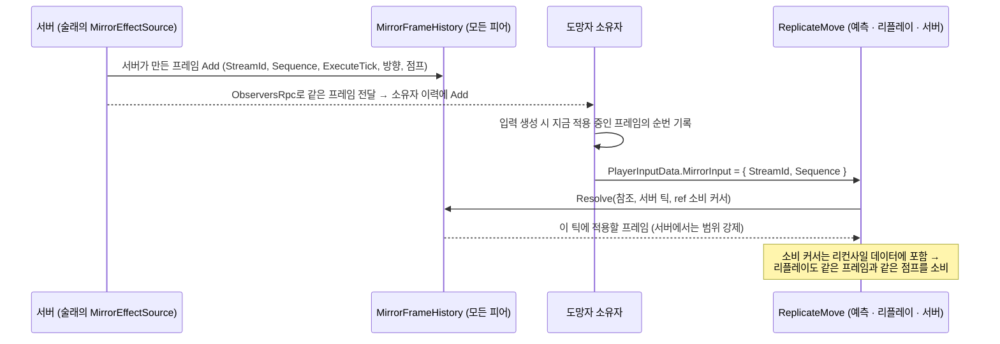

# 입력 미러링 — `MirrorFrameHistory`

[← README](../README.md)

**Mirror Pull**은 술래의 이동 입력을 지연시켜 모든 도망자의 수평 이동을 대신 조종하는 이 게임의 핵심 능력입니다. 이 문서는 그중 제가 만든 부분, 즉 초기 구조와 서버 검증을 다룹니다.

---

## 1. 무엇이 어려운가

FishNet 예측 모델에서는 **소유자만 자기 캐릭터를 예측**합니다. 그런데 Mirror Pull은 술래가 남의 캐릭터 수십 개를 움직이는 능력입니다.

처음 이 요구를 설명했을 때 AI는 "소유권을 깨야 하는 문제"라며 서버 권위 구조를 제안했습니다. 하지만 기획상 도망자도 미러링 중에 자기 입력으로 저항할 수 있었고, 그렇다면 소유권 문제가 아니라 **도망자 이동 공식에 외부 값 하나가 더해지는 문제**였습니다. 이 정리 덕분에 도망자는 계속 자기 클라이언트가 예측하고, 술래의 입력은 "도망자가 이동 계산에 쓰는 값"으로 다루게 됐습니다.

남은 문제는 이 외부 값을 리플레이에서도 똑같이 재현하는 것이었습니다. 리컨사일은 과거 틱을 다시 실행하므로, 그 틱에 어떤 미러 값이 적용됐는지가 정확히 남아 있어야 합니다.

---

## 2. 변천

| 시점 | 구조 | 작성 |
| --- | --- | --- |
| PR #1 | 시전자 플레이어마다 `MirrorEffectSource` 컴포넌트를 두고, 활성 여부와 술래 방향을 SyncVar로 동기화 | 본인 |
| PR #5, #8 | 술래 방향을 입력 데이터에 담아 왕복시키지 않고 `ReplicateMove`가 직접 읽게 해 반응 지연을 줄임. 틱별 방향 기록으로 리플레이 결정성 유지. 정지할 때 생기던 역주행을 선형 감속 대신 지수 감쇠로 제거 | 본인 |
| 2026-08 | SyncVar 방향을 서버가 예약하는 지연 프레임 큐로 교체 | 팀원 리팩토링 |
| **PR #88** | 서버가 만든 프레임 이력(`MirrorFrameHistory`)을 모든 피어에 두고, 도망자 소유자는 프레임 순번만 보냄 + 서버 검증 | 본인 |
| PR #103 | 시전 직후 술래 입력이 두 번 적용되던 문제 수정 | 본인 |

아래는 PR #88의 구조입니다.

---

## 3. PR #88 이전의 문제 — 서버가 소유자의 값을 그대로 믿음

팀 리팩토링 이후 도망자 소유자는 자기가 적용한 미러 프레임 **전체**(방향, 속도, 점프)를 입력에 담아 보냈고, 서버의 `ReplicateMove`는 그 값을 그대로 썼습니다. 조작된 클라이언트는 미러링을 무시하거나 원하는 방향으로 움직일 수 있었습니다.

목표는 두 가지였습니다.

1. 이동 값은 서버만 만든다. 소유자는 "어느 프레임으로 예측했는가"만 말한다.
2. 그래도 정상 클라이언트의 예측은 서버 결과와 일치해야 한다. 그렇지 않으면 매 시전이 리컨사일 스냅이 된다.

---

## 4. 구조



| 타입 | 역할 |
| --- | --- |
| `MirrorInputFrame` | 서버가 만든 이동 기록. `ExecuteTick`은 클라이언트에서도 항상 서버 타임라인 값 |
| `MirrorInputReference` | 소유자가 입력에 담는 요청. `StreamId`와 `Sequence`뿐이고 **이동 값이 없음** |
| `MirrorFrameHistory` | 서버가 만든 프레임만 보관하는 512칸 링 버퍼. 스트림(시전)이 바뀌면 이전 프레임과 남은 점프 이벤트를 버림 |
| `MirrorFrameHistory.Resolve` | 소유자가 고른 순번을 받아들이되, 서버에서는 허용 범위 안으로 제한하고 플레이어별 소비 커서를 전진 |

---

## 5. 설계 결정

### 5.1 시각 대신 순번

첫 구현(브랜치 커밋 `4742f552`)은 소유자가 "몇 틱에 샘플링했는가"를 보내고 서버가 그 시각으로 프레임을 다시 골랐습니다. 이 방식은 프레임 RPC가 늦게 도착할 때 깨졌습니다. 소유자는 아직 받지 못한 프레임 대신 이전 프레임으로 예측했는데, 서버는 그 시각에 이미 예정된 새 프레임을 골라 결과가 달라졌습니다.

어느 프레임이 도착해 있었는지는 소유자만 압니다. 그래서 다음 커밋(`683aa459`)에서 소유자가 **실제로 받은 프레임의 순번**을 보내게 바꿨습니다.

### 5.2 서버는 선택을 대신하지 않고 범위만 강제

서버는 소유자의 순번을 그대로 쓰되, 정상 클라이언트가 만들 수 없는 선택만 막습니다.

- 아직 실행 시각이 안 된 프레임 → 거부 (미래 정보)
- 0.25초보다 오래전에 대체된 프레임 → 거부 (미러링을 늦게 받는 척하기)
- 이미 소비한 커서보다 이전 프레임 → 거부 (되감기)
- 스트림이 다르거나 참조가 없는 입력 → **자유 이동이 아니라 지금 예정된 프레임**을 적용

```csharp
// MirrorFrameHistory.Resolve 중 — 소유자 순번 수용, 위조·누락 참조 처리
int index;
if (created && input.StreamId == StreamId)
{
    index = IndexAtSequence(input.Sequence);
}
else if (created && enforceServerWindow)
{
    // A forged or missing reference gets the current scheduled state, never free movement.
    index = IndexAtServerTick(serverTick);
}
else
{
    // No owner input (FishNet default or future data): keep the consumed frame.
    index = IndexAtSequence(playback.Sequence);
}
```

```csharp
// MirrorFrameHistory.Resolve 중 — 서버 범위 강제
if (enforceServerWindow)
{
    if (index >= 0 && At(index).ExecuteTick > serverTick)
    {
        index = IndexAtServerTick(serverTick);
    }
    uint oldestTick = serverTick > maximumAgeTicks ? serverTick - maximumAgeTicks : 0;
    int oldest = IndexAtServerTick(oldestTick);
    if (index < oldest)
    {
        index = oldest;
    }
}

MirrorInputFrame frame = index >= 0 ? At(index) : default;
if (frame.Sequence < playback.Sequence)
{
    frame = playback;
    index = IndexAtSequence(playback.Sequence);
}
```

범위 강제는 서버의 최초 실행에서만 켭니다. 클라이언트와 리플레이는 소유자가 고른 프레임을 그대로 재현해야 하기 때문입니다.

### 5.3 점프는 정확히 한 번

이동 방향은 "마지막 프레임 값"이면 되지만, 점프는 이벤트라 건너뛰면 사라지고 중복되면 두 번 뜁니다. 커서 이후 지나친 프레임들의 점프를 합쳐 한 번만 소비하고, 커서를 리컨사일 데이터(`PlayerInputData`의 `MirrorPlayback`)에 넣어 리플레이도 같은 점프를 같은 틱에 냅니다.

```csharp
// MirrorFrameHistory.Resolve 중 — 커서 이후의 점프를 한 번만 소비
bool jump = false;
bool fresh = playback.Sequence == 0;
for (int i = index; i >= 0 && frame.Sequence > playback.Sequence; i--)
{
    MirrorInputFrame candidate = At(i);
    if (candidate.Sequence <= playback.Sequence || (fresh && candidate.ExecuteTick < frame.ExecuteTick))
    {
        break;
    }
    jump |= candidate.IsActive && candidate.IsJump;
}

// Consume events even when movement will subsequently be blocked by immunity or a respawn.
frame.IsJump = false;
playback = frame;
frame.IsJump = frame.IsActive && jump;
return frame;
```

마지막 부분은 이동이 무적이나 리스폰으로 막히더라도 점프 이벤트는 소비 처리합니다. 그렇지 않으면 막힌 동안의 점프가 쌓였다가 풀리는 순간 한꺼번에 나갑니다.

### 5.4 이력 용량과 허용 나이는 별개

링 버퍼 용량(512)은 "얼마나 오래 보관하는가", `MaximumInputAgeSeconds`(0.25초)는 "얼마나 오래된 선택까지 허용하는가"입니다. 둘을 분리해 두어, 허용 범위를 조정해도 리플레이에 필요한 과거 프레임이 사라지지 않게 했습니다.

---

## 6. 테스트

`MirrorFrameHistoryTests`에 EditMode 테스트 13개를 작성했습니다.

| 다루는 경우 |
| --- |
| 위조된 스트림·순번, 참조 누락 |
| 소유자보다 늦게 도착한 프레임 |
| 0.25초 나이 창 경계 |
| 커서 되감기 시도 |
| 여러 프레임을 건너뛸 때 점프 단일 소비 |
| 스트림 교체 시 이전 프레임과 점프 폐기 |

네트워크 없이 순수 클래스로 분리했기 때문에, 지연 상황을 플레이 모드 없이 재현할 수 있었습니다.

---

## 7. 트러블슈팅

| 문제 | 원인 | 해결 |
| --- | --- | --- |
| 시전 중 프레임 RPC가 늦을 때마다 도망자가 리컨사일로 튐 | 서버가 소유자의 샘플 시각으로 프레임을 다시 골라, 소유자가 받지 못한 프레임을 적용 | 소유자가 받은 프레임의 순번을 보내고 서버는 범위만 검사 (PR #88) |
| Mirror Pull 시전 직후 술래가 같은 입력으로 두 번 움직임 | 시전부터 첫 지연 명령이 실행되기 전까지 자기 입력으로 즉시 이동한 뒤, 같은 입력이 지연 큐에서 다시 재생됨 | 이 대기 구간을 리컨사일되는 큐 상태에서 파생해(리플레이에서도 재현) 그동안 술래 자체의 이동·점프를 끔 (PR #103) |

---

## 8. AI 활용

| 단계 | AI에게 맡긴 것 | 내가 결정·검증한 것 |
| --- | --- | --- |
| 프레임워크 이해 | `IReplicateData` · `IReconcileData`, 소유권 모델 설명 | "이 프레임워크에서 남의 캐릭터를 움직이는 게 가능한가"를 먼저 물어 제약부터 파악 |
| 구조 | 클래스 구조 권고 | 역할 고정 여부, 도망자 입력 유무를 차례로 알려주자 AI 권고가 세 번 바뀜. 기획 제약을 정리해 "외부 값이 하나 더해지는 문제"로 축소 |
| 상태 위치 (PR #1) | 첫 구현 코드 | AI 첫 코드는 미러 상태를 라운드 관리자의 SyncVar에 뒀음. "적절한가"를 되물어 시전자별 `MirrorEffectSource`로 옮김. 각 클라이언트가 술래 이동에서 방향을 직접 계산하는 대안은 측정된 문제가 없어 보류 |
| 서버 검증 (PR #88) | 구현, 테스트 코드 | 신뢰 경계(소유자는 순번만), 허용 범위 기준 |

---

## 9. 범위 밖

- 술래 자신의 지연 명령 큐와 게이지 예측, 프레임 생성·전송 RPC는 팀원이 만든 구조입니다. 이 문서는 그 위에 얹은 이력·검증 부분만 다룹니다.
