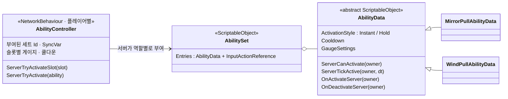
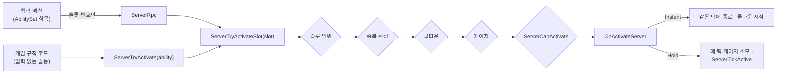

# 어빌리티 초기 설계 — `AbilityData`

[← README](../README.md)

Mirror Pull(동기화 스킬), 폭탄 인계, 상호작용, 유령의 바람 밀치기 같은 역할별 능력을 같은 규칙으로 발동하려고 처음 설계한 어빌리티 구조입니다.

> 이 문서는 처음 설계한 버전(2026-07)과 유령 어빌리티를 추가한 버전(2026-08)을 기준으로 합니다.
> 이후 팀 리팩토링(2026-10)으로 어빌리티가 플레이어 예측 시스템에 편입되면서 현재 구조는 크게 달라졌고, 그 부분은 이 문서 범위 밖입니다.

---

## 1. 요구사항

세 능력의 성격이 달랐습니다.

| | 상호작용 | 폭탄 인계 | Mirror Pull |
| --- | --- | --- | --- |
| 입력 | 단발 | 단발 | **누르고 있는 동안** |
| 조건 | 기계와 사거리 안 | 다른 도망자와 사거리 안 | 게이지 > 0 |
| 종료 | 즉시 | 즉시 | 키를 떼거나 게이지 고갈 |
| 특이점 | — | 입력 없이 규칙으로 발동될 수 있음 (예: 타이머 만료 시 강제 인계) | 지속 효과 |

공통 생명주기(입력 → 조건 검증 → 발동 → 유지 → 종료 → 쿨다운)를 한 곳에서 처리하고, 능력마다 다른 부분만 따로 구현하는 구조가 필요했습니다.

---

## 2. 구조



| 클래스 | 역할 |
| --- | --- |
| `AbilityData` | 어빌리티 정의. 발동 방식·쿨다운·게이지 설정과 서버 전용 훅만 가짐 |
| `AbilitySet` | 역할별 어빌리티 목록. 각 항목은 어빌리티와 (선택적) 입력 액션의 쌍 |
| `AbilityController` | 플레이어별 컴포넌트. 세트 부여, 입력 바인딩, 공통 검사, 게이지·쿨다운 등 **런타임 상태를 모두 소유** |

---

## 3. 발동 경로



- 클라이언트는 **슬롯 번호만** 요청합니다. 판정은 서버가 처음부터 다시 합니다.
- 입력 없이 코드로 발동하는 경우도 같은 검사를 거칩니다. 설계할 때는 타이머가 끝난 폭탄을 강제로 넘기는 규칙을 예로 들었는데, 이 규칙은 실제로 들어가지 않았습니다. 지금은 타이머가 끝나면 폭탄이 터집니다.

---

## 4. 설계 결정

### 4.1 SO에는 런타임 상태를 두지 않음

ScriptableObject는 모든 플레이어가 공유하는 에셋 하나입니다. 게이지나 쿨다운을 SO에 두면 술래가 둘일 때 게이지를 공유하는 버그가 납니다. 설정값은 SO, 런타임 상태는 플레이어별 `AbilityController`로 엄격히 나눴습니다.

```csharp
// 초기 버전 AbilityData.cs — 공통 검사는 컨트롤러, 어빌리티는 서버 전용 훅만 구현
/// <summary>
/// Ability-specific activation condition (e.g. target in range). Server only.
/// Common checks (cooldown/gauge/duplicate active) are AbilityController's job.
/// </summary>
public virtual bool ServerCanActivate(PlayerController owner) => true;

/// <summary>
/// Called every tick while a Hold ability is active. Return false to force-end.
/// Never called for Instant abilities. Server only.
/// </summary>
public virtual bool ServerTickActive(PlayerController owner, float deltaTime) => true;

/// <summary>
/// Effect start. Server only. Keep effect state on a component
/// (e.g. MirrorEffectSource); this method just flips the switch.
/// </summary>
public abstract void OnActivateServer(PlayerController owner);
```

효과의 상태도 SO가 아니라 효과를 받는 쪽 컴포넌트(`MirrorEffectSource`, `PushEffectReceiver`)에 둡니다. 어빌리티는 스위치를 켜는 역할만 합니다.

### 4.2 입력 바인딩은 어빌리티가 아니라 세트에

AI는 처음에 `AbilityData`에 `InputActionReference`를 넣자고 권했습니다. 저는 UE5 GAS에서 입력 바인딩이 선택 사항이었고, 사망·피격 반응처럼 코드로만 발동하는 어빌리티가 있었던 것을 근거로 반박했습니다.

- 폭탄 강제 인계처럼 입력 없이 발동해야 하는 규칙이 생길 수 있었습니다.
- 입력 필드를 비워 두는 어빌리티가 생기면 데이터 의미가 모호해집니다.
- "어떤 키로 발동하는가"는 어빌리티의 본질(조건 + 효과)이 아니라 그 역할의 조작 설정입니다.

그래서 입력은 `AbilitySet.Entry`에 두고, 같은 어빌리티를 다른 세트에서 다른 키로 쓰거나 키 없이 쓸 수 있게 했습니다.

### 4.3 어빌리티와 상태의 구분 기준

GAS처럼 사망·피격까지 어빌리티로 만드는 것은 기각했습니다. GAS에서 그게 자연스러운 이유는 AbilityTask · GameplayTag · GameplayEvent 인프라가 받쳐주기 때문이고, 그걸 재현하면 GAS를 이식하는 프로젝트가 됩니다. 대신 기준을 정했습니다.

> **쿨다운이나 발동 조건이 의미 있으면 어빌리티, "지금 이 캐릭터가 어떤 상태인가"를 서술하면 상태(SyncVar).**

폭탄 인계(행동)는 어빌리티, 폭탄 보유(사실)는 상태. 잡힘·탈락도 상태입니다.

---

## 5. 확장 예시: 유령의 바람 밀치기

탈락한 플레이어가 유령이 되는 시스템을 추가하면서, 유령 전용 능력을 이 구조로 만들었습니다. `AbilityData`와 `AbilityController`는 수정하지 않았습니다.

```csharp
// 유령 추가 시점 WindPullAbilityData.cs — 새 어빌리티 = SO 하위 클래스 하나
/// <summary>
/// 유령의 바람 밀치기. 서버가 전방 구체 판정으로 살아있는 플레이어를 찾아
/// 각자의 PushEffectReceiver에 밀침 속도를 주입한다.
/// </summary>
public class WindPullAbilityData : AbilityData
{
    // … 튜닝 필드 (Radius, ForwardOffset, PushSpeed, UpwardRatio, PushDurationSeconds)

    public override bool ServerCanActivate(Player owner)
    {
        return owner != null && owner.Role == PlayerRole.Ghost;
    }
```

```csharp
// 유령 추가 시점 WindPullAbilityData.OnActivateServer 중
Vector3 origin = owner.transform.position + owner.transform.forward * ForwardOffset;
Collider[] hits = Physics.OverlapSphere(origin, Radius, LayerDefine.Player, QueryTriggerInteraction.Ignore);
for (int i = 0; i < hits.Length; i++)
{
    Player target = Util.GetComponent<Player>(hits[i].gameObject);
    if (target == null || target == owner || !target.IsAlive)
        continue;
    if (target.Role != PlayerRole.Tagger && target.Role != PlayerRole.Runner)
        continue;

    // … 수평 방향 + 위로 띄우는 성분(UpwardRatio)으로 velocity 계산

    var receiver = Util.GetComponent<PushEffectReceiver>(target);
    receiver?.ServerApplyPush(velocity, PushDurationSeconds);
}
```

### 밀침을 예측과 맞추는 방법

서버가 플레이어 위치를 직접 옮기면, 그 플레이어의 클라이언트 예측이 리컨사일에서 되돌려져 고무줄처럼 튑니다. 그래서 서버는 `PushEffectReceiver`에 **밀침 속도와 남은 틱 수**만 넣고, 실제 이동은 `ReplicateMove`가 매 틱 그 값을 소비해 계산합니다. 두 값은 리컨사일 스냅샷에 포함됩니다.

Mirror Pull은 지속 효과라 프레임 큐가 필요하지만, 밀침은 한 번 주입된 뒤 감쇠할 뿐이라 리컨사일 스냅샷만으로 모든 피어가 수렴합니다. 감쇠율을 SO 값이 아니라 상수로 둔 것도 같은 이유입니다. 스냅샷에 속도와 남은 틱만 있으면 리플레이가 서버와 같은 궤적을 냅니다.

이 수신기는 이후 맵 장애물의 격벽 축출에도 그대로 재사용됐습니다 ([01 맵 장애물 §5.7](01-map-obstacle.md#57-격벽-축출은-밀치기-수신기를-재사용)).

---

## 6. AI 활용

| 단계 | AI에게 맡긴 것 | 내가 결정·검증한 것 |
| --- | --- | --- |
| 생명주기 추출 | 세 능력의 공통 생명주기 정리, `ActivationStyle` + 가상 훅 구조안, 코드 초안 | SO 런타임 상태 금지 원칙 채택 |
| 입력 바인딩 | `AbilityData`에 입력 액션을 두는 안 | GAS 경험을 근거로 반박해 `AbilitySet`으로 분리. GAS 전체 이식은 경계해 사망·피격 어빌리티화는 기각, 어빌리티 / 상태 구분 기준 결정 |
| 유령 설계 | 기존 코드 9개 파일을 읽고 내 구상의 충돌 지점 검토 | 내 구상(역할 추가, 탈락 시 전환)을 먼저 제시하고 점검을 요청. 적용 전 "작성한 코드를 스스로 점검하라"는 단계를 끼워 넣음 |

유령 설계 검토에서는 AI가 "현재 탈락 처리가 오브젝트를 디스폰하므로 유령이 살아남을 수 없다"는 충돌을, 적용 전 자체 점검에서는 늦게 접속한 클라이언트에서 역할 비주얼이 갱신되지 않는 결함 등을 찾았습니다. 발견은 AI가 했고, 제 기여는 설계안을 먼저 내고 검증 단계를 절차에 넣은 것입니다.
