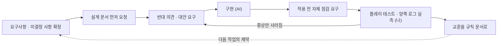

# AI 활용 방식

[← README](../README.md)

이 프로젝트의 코드는 대부분 AI(Claude)가 작성했습니다. 저는 무엇을 만들지, AI의 답 중 무엇을 적용할지, 그리고 그것이 실제로 맞는지를 결정하고 검증했습니다. 이 문서는 그 방식과, 가장 오래 걸렸던 버그 하나를 처음부터 끝까지 기록한 것입니다.

---

## 1. 작업 방식



| 작업 | 주체 |
| --- | --- |
| 코드베이스 읽기, 영향 범위 추적 | AI (MCP로 프로젝트 직접 접근) |
| 첫 설계안 | 대부분 내가 먼저 제시하고 점검 요청 |
| 설계안의 반례·충돌 지점 찾기 | AI |
| 설계 선택 확정 | 나 |
| 코드 작성 | AI |
| 적용 여부·순서 결정 | 나 |
| 플레이 테스트, 계측 실행 | 나 |
| 로그 해석, 가설 수립 | AI — 단, 내 실측이 전제를 두 번 뒤집음 |
| 설계·가이드 문서 본문 | AI가 쓰고, 범위와 형태는 내가 지정 |

**도구** — Claude, MCP for Unity(에디터 연동), 파일시스템 MCP, FishNet Latency Simulator

**작업 규칙**
- AI가 Unity 씬을 임의로 수정한 뒤로, 에디터를 직접 건드릴 때는 먼저 알리게 했습니다. 이후 코드 변경과 에디터 조작이 분리됐습니다.
- 팀 주석 규칙(영문, 클래스·메서드 위 책임 설명, 설계 근거는 코드가 아니라 문서에)을 AI 코드에도 강제했습니다. 설계 근거는 설계 문서(`MAP_OBSTACLE_DESIGN.md`, `GHOST_SYSTEM_DESIGN.md`)에, 틱 처리 규칙은 `TICK_DOMAIN_GUIDE.md`에 남겼습니다.
- 받은 코드는 동작한 뒤에도 따로 질문해 이해하고 넘어갔습니다. 그 이해로 나중에 AI가 내린 설계 결정 자체를 다시 물을 수 있었습니다 (사례 3).

---

## 2. 사례

### 사례 1 — 어빌리티 입력 설계: 내 도메인 지식으로 AI 제안 반박

AI는 `AbilityData`에 입력 액션 참조를 넣자고 권했습니다. 저는 UE5 GAS에서 입력 바인딩이 선택적이었고, 사망·피격 반응처럼 코드로만 발동하는 어빌리티가 있었다는 경험으로 반박했습니다. AI는 직전 권고를 "레이어 위반"으로 정정했고, 입력 바인딩은 `AbilitySet`으로 분리됐습니다.

동시에 GAS를 통째로 옮기지 않도록 경계했습니다. 사망·피격까지 어빌리티로 만드는 안은 기각하고, "쿨다운·조건이 있으면 어빌리티, 지속되는 사실이면 상태"라는 기준을 정했습니다. → [03 어빌리티](03-ability.md)

### 사례 2 — 미러 상태 위치: 묻지 않으면 AI는 자기 설계의 결함을 말하지 않는다

AI의 첫 코드는 미러링 상태(활성 여부, 매 틱 바뀌는 방향)를 라운드 관리자의 SyncVar에 뒀습니다. 동작은 했지만 "이 위치가 적절한가"를 되물었고, AI는 세 가지 문제를 인정했습니다. 갱신 주기가 다른 상태가 섞이고, 스킬이 늘 때마다 라운드 관리자에 변수가 붙고, 술래가 둘이 되면 깨집니다.

상태를 시전자별 `MirrorEffectSource`로 옮겼고, 각 클라이언트가 술래 이동에서 방향을 직접 계산하는 대안은 측정된 문제가 없어 보류했습니다. → [02 입력 미러링](02-input-mirroring.md)

### 사례 3 — 맵 장애물: 반대 의견을 요구하고, AI의 정당화를 실측으로 확인

- 첫 요청에서 바로 코드를 받지 않고 설계 문서부터 요청했고, 미결정 사항(격벽 축출 방식, 튜닝 값 SO화, 유령 충돌 여부)을 확정한 뒤 구현을 맡겼습니다.
- 연출 분리를 맡길 때 "가능한지 판단하고, 아니면 반대 의견을 달라"고 했습니다. 그 결과 "무버에는 단계가 없고 점프대 발사는 리플레이 때 재발생한다"는 반례가 먼저 나와, 단계 공급을 단계 있는 장애물로 한정하는 구조가 됐습니다.
- AI는 무버를 플레이어마다 다른 틱으로 배치하는 설계에 대해 "전역 일관성 대신 플레이어별 권위 일치를 택한, 감수할 만한 대가"라고 설명했습니다. 이 대가를 다시 따져 물었고, 원격 플레이에서 실제 버그로 드러나 맵 틱을 입력에 싣는 구조로 바꿨습니다 (PR #88).

→ [01 맵 장애물 §6](01-map-obstacle.md#6-틱-좌표계--네-번의-설계)

### 사례 4 — 버프 틱 버그: 증상이 사라진 수정을 받아들이지 않기

가장 오래 걸렸고, AI 활용 방식이 가장 많이 바뀐 사례입니다.

**증상** — 이동 중 캐릭터가 주기적으로 뒤로 끌렸고, 이동이 빠른 플레이어일수록 심했습니다.

**진단이 좁혀진 순서**

```
이동 중 뒤로 끌림
 └ 이동이 빠를수록 심함        → 틱당 고정 오차 (속도는 증폭기일 뿐)
    └ 폭탄이 붙어 있는 동안만   → 폭탄 이속 버프로 범위 특정
       └ 버프는 가속(×2)       → "감속일 것"이라는 AI 예측 반증
          └ 첫 수정 후 버프가 늦게 걸림 → 가짜 수정 적발
             └ 원격 클라이언트에서만 + 서버·클라이언트 양쪽 로그 → 원인 확정
                └ 같은 유형 전역 감사 → 맵 장애물에서 같은 유형 버그 추가 발견
```

**1차 수정 — 증상만 사라짐 (PR #31)**

AI는 버프 목록에 값이 들어오는 경로가 둘인데, 한쪽만 클라이언트 틱으로 환산(`TickToLocalTick`)한다는 것을 찾았습니다. 둘 중 하나는 틀렸다고 보고 환산을 제거했고, 끌림은 사라졌습니다.

하지만 그 뒤 "폭탄을 받았을 때 버프가 한 5초는 늦게 걸리는 것 같다"는 것을 발견했습니다. 끌림이 사라졌다고 끝내지 않고 버프가 실제로 걸리는지를 따로 확인한 덕분입니다. AI는 자기 모델로는 이 지연을 설명할 수 없다고 인정하고, 추론 대신 계측 지점을 제안했습니다.

**양쪽 로그 실측 — 모델이 뒤집힘**

그때까지는 클라이언트 로그만 봤습니다. 서버와 클라이언트 양쪽의 `ReplicateMove`에서 같은 항목을 찍어 함께 올렸습니다.

| 위치 | 로그 |
| --- | --- |
| 클라이언트 | `owner=True  replicate=165~168  Tick=1284  LocalTick=168` |
| 클라이언트 | `owner=False replicate=1278     Tick=1284  LocalTick=168` |
| 서버 | `owner=True  replicate=2583     Tick=2583  LocalTick=2583` |
| 서버 | `owner=False replicate=904      Tick=2583  LocalTick=2583` |
| 서버 | `[Buff/Schedule] changeTick=2244 serverTick=2236` |
| 클라이언트 | `[Buff/Wait] tick=1260 start=2244` |

이 로그로 리플리케이트 틱이 **그 플레이어를 소유한 클라이언트의 로컬 틱 공간**이라는 것이 확정됐습니다. 서버는 같은 순간에 호스트를 2583, 원격 플레이어를 904로 시뮬레이션합니다. 다시 계산하니 원래 코드에서 틀린 쪽은 클라이언트가 아니라 서버였습니다.

| | 버프 시작 틱 | 비교 대상(입력 틱) | 결과 |
| --- | --- | --- | --- |
| 클라이언트 (원래 코드) | 환산 후 1128 | 1260 | 켜짐 ✅ |
| 서버 (원래 코드) | 서버에선 환산이 항등 → 2244 | 904 | 꺼짐 ❌ |

클라이언트만 2배속으로 앞서 가고, 리컨사일이 뒤로 당긴 것입니다. 1차 수정은 양쪽을 똑같이 2244로 만들어 **둘 다 꺼진 상태로 일치**시켰을 뿐이었습니다. 리컨사일 오차는 사라졌지만 버프가 걸리지 않았던 이유입니다. 호스트 자기 플레이어는 로컬 틱과 서버 틱이 같아서 문제가 보이지 않았습니다.

**실제 수정 (PR #32 되돌림 → PR #33)**

- 버프 틱을 모두 **소유자의 리플리케이트 틱 공간**으로 통일했습니다.
- 서버가 그 플레이어의 마지막 입력 틱(`PlayerController.LastReplicateTick`)을 기준으로 버프 변경 틱을 예약합니다.
- 서버 틱처럼 보이는 파라미터 이름(`serverStartTick`)이 착각의 직접적 원인이어서 `startTick`으로 바꾸고 요구 좌표계를 주석에 명시했습니다.

**그다음**

같은 유형의 버그를 전역으로 찾게 했고, 맵 장애물의 틱 환산에서 같은 실수가 하나 더 나왔습니다. 그리고 세 틱 좌표계와 "시점 vs 길이" 판별 규칙을 팀 문서 `TICK_DOMAIN_GUIDE.md`로 정리했습니다.

**이 과정에서 AI가 틀렸던 지점**
- 처음 준 계측 코드는 현재 예측 위치와 1 RTT 전 서버 위치를 비교해, 오차가 아니라 "클라이언트가 얼마나 앞서 있는가"를 쟀습니다. 제가 실행해서 보고한 수치를 보고 AI가 정정했습니다.
- Latency Simulator의 패킷 손실 값을 퍼센트로 안내했지만 실제 필드는 0~1 비율이라, 한동안 18% 손실 조건에서 테스트했습니다.

---

## 3. 배운 점

1. **설계를 묻기 전에 기획 제약을 전부 적는다.** 역할 고정 여부, 도망자 입력 유무를 나중에 알려 AI의 구조 권고가 세 번 바뀌었습니다.
2. **증상이 사라진 것과 고쳐진 것은 따로 확인한다.** 동기화 버그는 서버·클라이언트 양쪽 로그를 같은 틱끼리 나란히 줘야 했습니다. 한쪽 로그만 보는 것은 차이가 아니라 값을 재는 것이었습니다.
3. **AI는 묻지 않으면 자기 설계의 대가를 먼저 말하지 않는다.** 반대 의견을 요구하고, AI의 정당화는 실측으로 확인합니다.
4. **코드로 볼 수 없는 정보는 내가 줘야 한다.** 프리팹 계층, 인스펙터 설정, 다른 세션에서 바꾼 코드가 그렇습니다. 격벽 연출 버그는 AI가 코드 원인을 두 번 추측한 끝에, 인스펙터 스크린샷 한 장으로 끝났습니다.
